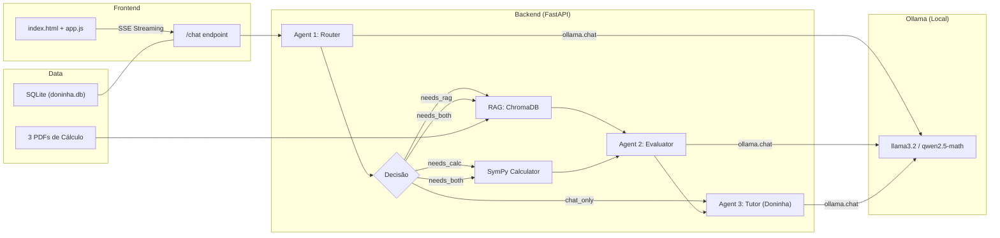
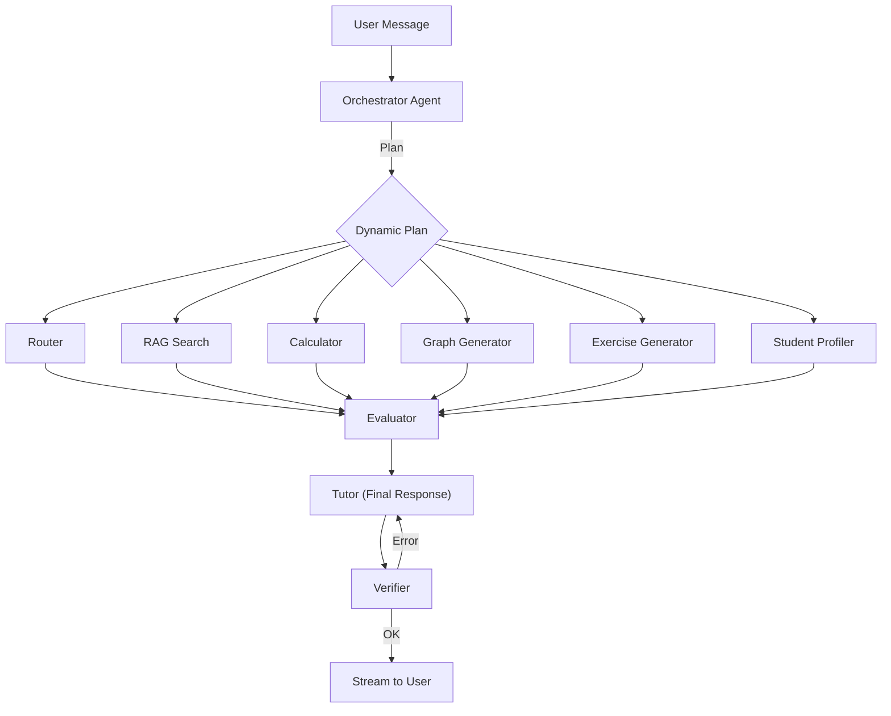
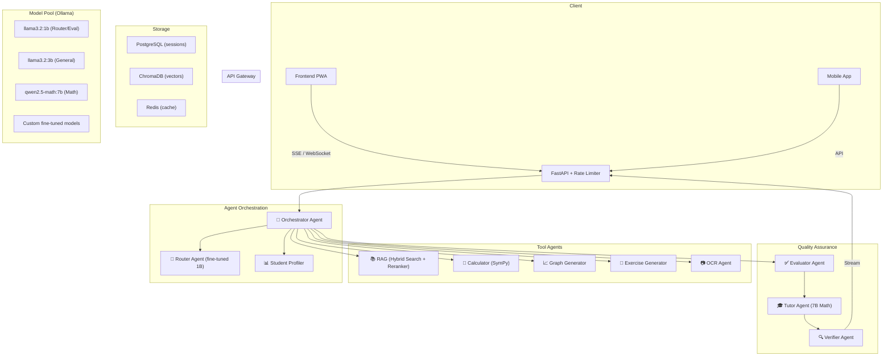

# 🦡 Doninha Matemática — Análise Completa & Roadmap de Melhorias

> Análise técnica aprofundada do estado atual do projeto com sugestões de melhorias organizadas por prioridade, impacto e complexidade.

---

## 📋 Índice

1. [Visão Geral do Projeto](#1-visão-geral-do-projeto)
2. [Análise do Estado Atual](#2-análise-do-estado-atual)
3. [Problemas Críticos Identificados](#3-problemas-críticos-identificados)
4. [Melhorias no Sistema de Agentes](#4-melhorias-no-sistema-de-agentes)
5. [Fine-Tuning & Modelos Especializados](#5-fine-tuning--modelos-especializados)
6. [Novos Agentes Propostos](#6-novos-agentes-propostos)
7. [Melhorias no RAG](#7-melhorias-no-rag)
8. [Melhorias no Backend](#8-melhorias-no-backend)
9. [Melhorias no Frontend](#9-melhorias-no-frontend)
10. [Infraestrutura & DevOps](#10-infraestrutura--devops)
11. [Roadmap de Implementação](#11-roadmap-de-implementação)

---

## 1. Visão Geral do Projeto

### Arquitetura Atual



### Stack Tecnológica

| Camada | Tecnologia | Status |
|--------|-----------|--------|
| **LLM** | Ollama (llama3.2) | ✅ Funcional |
| **Backend** | FastAPI + Uvicorn | ✅ Funcional |
| **Agentes** | Pipeline sequencial (Router → Evaluator → Tutor) | ✅ Funcional |
| **RAG** | ChromaDB + HuggingFace Embeddings (all-MiniLM-L6-v2) | ✅ Funcional |
| **Cálculo** | SymPy | ✅ Funcional |
| **DB** | SQLite via SQLAlchemy | ✅ Funcional |
| **Frontend** | HTML/CSS/JS + KaTeX + Marked.js | ✅ Funcional |

### Pontos Fortes Identificados

- ✅ Pipeline multi-agente bem estruturado (Router → Evaluator → Tutor)
- ✅ SSE streaming real com feedback de status por etapa
- ✅ Fallbacks robustos em todos os agentes (erros nunca travam o sistema)
- ✅ Separação limpa de cálculo exato (SymPy) vs raciocínio (LLM)
- ✅ Frontend com estilo terminal/hacker muito coerente e LaTeX funcional
- ✅ Persistência de sessões com device_id para multi-dispositivo
- ✅ Suporte a DeepSeek `<think>` blocks

---

## 2. Análise do Estado Atual

### 2.1 Agentes ([agents.py](file:///c:/Users/muril/OneDrive/Documentos/doninha%20matematica/agents.py))

| Aspecto | Avaliação | Nota |
|---------|-----------|------|
| Clareza dos prompts | Boa — prompts claros e com exemplos JSON | 8/10 |
| Fallback handling | Excelente — `_parse_json_safe` com 3 camadas de fallback | 9/10 |
| Modularidade | Boa — cada agente é uma função isolada | 8/10 |
| Escalabilidade | Limitada — pipeline hardcoded, sem orquestrador dinâmico | 5/10 |
| Observabilidade | Básica — apenas `print()` statements | 4/10 |

**Gaps identificados:**
- Sem cache de decisões do Router para perguntas repetidas
- O Evaluator recebe todo o contexto cru — sem pré-processamento
- Não há agente de "revisão" ou "qualidade" da resposta final
- Sem memória de longo prazo (o agente não lembra do perfil do aluno)

### 2.2 Backend ([backend.py](file:///c:/Users/muril/OneDrive/Documentos/doninha%20matematica/backend.py))

| Aspecto | Avaliação | Nota |
|---------|-----------|------|
| Estrutura da API | Boa — endpoints RESTful claros | 7/10 |
| Gerenciamento de sessão | Funcional — UUID + SQLite | 7/10 |
| Streaming | Excelente — SSE bem implementado | 9/10 |
| Segurança | Fraca — CORS wildcard, sem auth, SQL injection mitigado pelo ORM | 3/10 |
| Error handling | Básico — try/catch genérico | 5/10 |
| Testes | Inexistentes — `test_llm.py` está desatualizado (usa API não-streaming) | 2/10 |

**Gaps identificados:**
- Migração SQL manual no startup (`ALTER TABLE`) — frágil
- `system_instruction` hardcoded no backend (deveria ser configurável)
- Sem rate limiting
- Sem validação de tamanho do input do usuário
- Context window não é gerenciada (pode estourar com sessões longas)
- `datetime.utcnow` está deprecated — usar `datetime.now(timezone.utc)`

### 2.3 RAG ([rag/](file:///c:/Users/muril/OneDrive/Documentos/doninha%20matematica/rag/))

| Aspecto | Avaliação | Nota |
|---------|-----------|------|
| Ingestão | Funcional — PDF → chunks → ChromaDB | 6/10 |
| Chunking | Básico — tamanho fixo 1000 chars, sem semântica | 5/10 |
| Embeddings | Adequado — all-MiniLM-L6-v2 é um bom modelo leve | 7/10 |
| Retrieval | Básico — apenas similarity_search, sem reranking | 5/10 |
| Qualidade | Limitada — PDFs de cálculo têm muitas fórmulas que viram lixo em texto | 4/10 |

**Gaps identificados:**
- Sem pré-processamento de fórmulas matemáticas nos PDFs
- `k=3` fixo — deveria ser dinâmico baseado na confiança
- ChromaDB é instanciado a cada query (deveria ser singleton)
- Sem scores de similaridade (não filtra por threshold)
- Sem metadata (página, livro, capítulo) nos resultados

### 2.4 Frontend ([frontend/](file:///c:/Users/muril/OneDrive/Documentos/doninha%20matematica/frontend/))

| Aspecto | Avaliação | Nota |
|---------|-----------|------|
| Design | Excelente — tema terminal coeso e bonito | 9/10 |
| LaTeX rendering | Bom — sanitizeLatex é robusto | 8/10 |
| UX | Bom — streaming com status visual | 7/10 |
| Acessibilidade | Fraca — sem aria-labels, sem contraste verificado | 3/10 |
| Mobile | Básico — funciona mas UX degradada | 5/10 |
| Funcionalidades | Limitado — sem deletar sessão, exportar, copiar, etc. | 4/10 |

### 2.5 Banco de Dados ([db/](file:///c:/Users/muril/OneDrive/Documentos/doninha%20matematica/db/))

| Aspecto | Avaliação | Nota |
|---------|-----------|------|
| Schema | Simples e funcional | 7/10 |
| Migrações | Inexistentes — ALTER TABLE manual | 2/10 |
| Escalabilidade | Limitada — SQLite single-writer | 5/10 |

---

## 3. Problemas Críticos Identificados

> [!CAUTION]
> Estes problemas devem ser resolvidos ANTES de adicionar novas features.

### 3.1 Context Window Overflow
O sistema carrega **todo** o histórico da sessão para enviar ao modelo. Com sessões longas, isso **estoura** o context window do llama3.2 (128K tokens, mas efetivo ~4K-8K para SLMs).

```python
# backend.py L228-234 — PROBLEMA: carrega TUDO
mensagens_bd = (
    db.query(models.Message)
    .filter(models.Message.session_id == session_id)
    .order_by(models.Message.id)
    .all()
)
historico = [{"role": m.role, "content": m.content} for m in mensagens_bd]
```

**Solução proposta:**
```python
# Sliding window: manter system prompt + últimas N mensagens
MAX_HISTORY = 20  # ~10 turnos de conversa

mensagens_bd = (
    db.query(models.Message)
    .filter(models.Message.session_id == session_id)
    .order_by(models.Message.id)
    .all()
)

# Separa system prompt das mensagens
system_msgs = [m for m in mensagens_bd if m.role == "system"]
chat_msgs = [m for m in mensagens_bd if m.role != "system"]

# Sliding window: mantém as mais recentes
if len(chat_msgs) > MAX_HISTORY:
    chat_msgs = chat_msgs[-MAX_HISTORY:]

historico = [{"role": m.role, "content": m.content} for m in system_msgs + chat_msgs]
```

### 3.2 ChromaDB Instanciado a Cada Query
O retriever cria uma nova instância do ChromaDB **em cada chamada**, o que é lento e desperdício de memória.

```python
# rag/retriever.py L22 — PROBLEMA: instância nova a cada busca
db = Chroma(persist_directory=CHROMA_PATH, embedding_function=embeddings)
```

**Solução: singleton**
```python
_chroma_db = None

def _get_chroma_db():
    global _chroma_db
    if _chroma_db is None:
        _chroma_db = Chroma(persist_directory=CHROMA_PATH, embedding_function=embeddings)
    return _chroma_db
```

### 3.3 Test Suite Desatualizada
[test_llm.py](file:///c:/Users/muril/OneDrive/Documentos/doninha%20matematica/test_llm.py) ainda espera resposta JSON síncrona, mas o backend agora usa SSE streaming. O teste está **completamente quebrado**.

### 3.4 CORS Wildcard em Produção
```python
# backend.py L31-37 — PROBLEMA: aceita qualquer origem
allow_origins=["*"],
```

---

## 4. Melhorias no Sistema de Agentes

### 4.1 Cache Semântico para o Router

O Router faz uma chamada LLM para **cada** mensagem, mesmo perguntas triviais como "oi" ou "obrigado". Um cache semântico evita chamadas desnecessárias.

```python
# Implementação: cache por similaridade de embedding
from functools import lru_cache
import hashlib

ROUTER_CACHE = {}

def router_agent_cached(user_message: str, model: str) -> dict:
    # Hash simples para mensagens idênticas
    key = hashlib.md5(user_message.lower().strip().encode()).hexdigest()
    if key in ROUTER_CACHE:
        print(f"  [ROUTER] Cache hit!")
        return ROUTER_CACHE[key]
    
    result = router_agent(user_message, model)
    ROUTER_CACHE[key] = result
    return result
```

**Nível avançado:** usar embeddings para cache por **similaridade** (se uma pergunta é 95% similar a outra já classificada, reusar a decisão).

### 4.2 Prompt Engineering Aprimorado

#### Router com Chain-of-Thought
```
ROUTER_PROMPT_V2 = """You are a classification assistant. Analyze the user's message step by step.

Step 1: Identify the language (for search_term extraction)
Step 2: Determine if math concepts, calculations, or neither are needed
Step 3: Classify and output JSON

Categories:
- "chat_only": Greeting, thanks, or non-math questions
- "needs_rag": Asking about theory, definitions, theorems, proofs, or concepts
- "needs_calc": Wants a specific calculation, equation solved, or numerical answer
- "needs_both": Needs theory AND a calculation
- "needs_graph": Wants to visualize a function or data (NEW!)

Additional fields:
- "confidence": 0.0-1.0 (how sure you are)
- "search_term": optimized English search term for textbook lookup
- "calc_expression": mathematical expression in standard notation
- "difficulty_level": "basic" | "intermediate" | "advanced"

Respond with ONLY valid JSON. Think before classifying.
"""
```

#### Evaluator com Scores de Relevância
```
EVALUATOR_PROMPT_V2 = """You are a relevance evaluator. Score the context quality.

Output JSON with:
- "relevance_score": 0.0-1.0 (0 = garbage, 1 = perfect match)
- "useful_context": cleaned, relevant portions only
- "missing_info": what the context lacks that would help answer the question
- "confidence": 0.0-1.0

Only include context with relevance_score > 0.5.
"""
```

### 4.3 Structured Output (JSON Mode)

Ollama suporta `format="json"` para garantir saída JSON válida, eliminando a necessidade do `_parse_json_safe`:

```python
def router_agent(user_message: str, model: str) -> dict:
    response = ollama.chat(
        model=model,
        messages=[
            {"role": "system", "content": ROUTER_PROMPT},
            {"role": "user", "content": user_message},
        ],
        stream=False,
        format="json",  # ← GARANTE JSON VÁLIDO
        options={"temperature": 0.1, "num_predict": 150},
    )
    # ...
```

> [!TIP]
> O `format="json"` do Ollama usa grammar-based sampling para garantir JSON válido. Isso elimina ~90% dos erros de parsing e torna o `_parse_json_safe` um fallback puro.

### 4.4 Modelo Dedicado por Agente

Usar um modelo diferente para cada agente pode melhorar dramáticamente a performance:

| Agente | Modelo Recomendado | Justificativa |
|--------|-------------------|---------------|
| **Router** | `llama3.2:1b` ou `qwen2.5:0.5b` | Tarefa simples de classificação — modelo tiny é suficiente |
| **Evaluator** | `llama3.2:1b` | Filtragem binária — não precisa de modelo grande |
| **Tutor** | `llama3.2:latest` (3B) ou `qwen2.5:7b` | Precisa de qualidade na didática |
| **Tutor (Math)** | `qwen2.5-math:7b` | Quando o Router detecta cálculo avançado |

```python
# Configuração multi-modelo
AGENT_MODELS = {
    "router": "llama3.2:1b",       # Rápido, baixo custo
    "evaluator": "llama3.2:1b",    # Rápido, baixo custo
    "tutor": "llama3.2",           # Qualidade na resposta
    "tutor_math": "qwen2.5-math",  # Especialista em matemática
}
```

---

## 5. Fine-Tuning & Modelos Especializados

### 5.1 Quando Fine-Tuning Faz Sentido

> [!IMPORTANT]
> Fine-tuning só vale a pena quando **prompt engineering + RAG** não atingem a qualidade desejada. Avalie na seguinte ordem:
> 1. **Prompt engineering** (custo zero)
> 2. **Few-shot examples no prompt** (custo zero)
> 3. **RAG com dados melhores** (baixo custo)
> 4. **Fine-tuning** (alto custo de tempo/dados)

### 5.2 Fine-Tuning do Router (Recomendado ⭐)

O Router é o **melhor candidato** para fine-tuning porque:
- Tarefa simples e bem definida (classificação)
- Fácil de gerar dados de treino
- Modelo tiny (1B params) = treinamento rápido

**Dados de treino necessários (~500-1000 exemplos):**

```jsonl
{"messages": [{"role": "system", "content": "Classify the math question."}, {"role": "user", "content": "What is the derivative of x^2?"}, {"role": "assistant", "content": "{\"action\": \"needs_rag\", \"search_term\": \"derivative power rule\"}"}]}
{"messages": [{"role": "system", "content": "Classify the math question."}, {"role": "user", "content": "Solve 3x + 5 = 20"}, {"role": "assistant", "content": "{\"action\": \"needs_calc\", \"calc_expression\": \"3*x + 5 = 20\"}"}]}
{"messages": [{"role": "system", "content": "Classify the math question."}, {"role": "user", "content": "Hi there!"}, {"role": "assistant", "content": "{\"action\": \"chat_only\"}"}]}
```

**Pipeline de Fine-Tuning com Ollama:**
```bash
# 1. Preparar Modelfile
cat > Modelfile.router << EOF
FROM llama3.2:1b
ADAPTER ./router_adapter.gguf
SYSTEM "You are a math question classifier. Respond with JSON only."
PARAMETER temperature 0.1
PARAMETER num_predict 150
EOF

# 2. Treinar com Unsloth (mais eficiente para LoRA)
# Ou usar o MLX no Mac, ou PEFT no Windows com CUDA
python train_router.py --dataset router_train.jsonl --epochs 3 --lr 2e-5

# 3. Converter para GGUF e registrar no Ollama
python convert_to_gguf.py --adapter router_adapter
ollama create doninha-router -f Modelfile.router
```

### 5.3 Fine-Tuning do Tutor (Avançado)

Para personalizar o estilo didático do Tutor:

**Dados necessários (~2000-5000 exemplos):**
- Conversas tutor-aluno reais (ou geradas sinteticamente)
- Respostas com formatação LaTeX correta
- Exemplos de abordagem socrática
- Exemplos de correção gentil de erros

**Geração Sintética de Dados (usando GPT-4 ou Claude):**
```python
# Script para gerar dados de treino sintéticos
GENERATION_PROMPT = """
Generate a realistic math tutoring conversation between a student and the 
"Doninha Matemática" tutor. The tutor should:
1. Use LaTeX formatting ($...$ and $$...$$)
2. Be patient and encouraging
3. Show step-by-step solutions
4. Explain the "why" not just the "how"

Topic: {topic}
Difficulty: {difficulty}
Student profile: {profile}

Generate 3-5 message pairs.
"""
```

### 5.4 Modelos Especializados para Matemática

| Modelo | Parâmetros | Especialidade | Uso Sugerido |
|--------|-----------|---------------|-------------|
| `qwen2.5-math:7b` | 7B | Raciocínio matemático | Tutor principal para problemas complexos |
| `qwen2.5-math:1.5b` | 1.5B | Cálculos rápidos | Validação de respostas |
| `deepseek-math:7b` | 7B | Provas e raciocínio formal | Demonstrações avançadas |
| `phi-3-mini` | 3.8B | Raciocínio geral eficiente | Router e Evaluator |
| `mathstral:7b` | 7B | Matemática (Mistral) | Alternativa ao qwen |

### 5.5 Evaluation Framework

Antes de fine-tuning, implementar um framework de avaliação:

```python
# eval/benchmark.py
MATH_EVAL_DATASET = [
    {
        "question": "Find the derivative of f(x) = x³ + 2x",
        "expected_action": "needs_both",
        "expected_answer_contains": ["3x²", "power rule"],
        "difficulty": "basic",
    },
    {
        "question": "Prove that the limit of 1/n as n→∞ is 0",
        "expected_action": "needs_rag",
        "expected_answer_contains": ["epsilon", "for all", "there exists"],
        "difficulty": "advanced",
    },
    # ... 100+ exemplos cobrindo todos os tópicos
]

def evaluate_pipeline(model_config):
    results = {"router_accuracy": 0, "answer_quality": 0, "latex_correct": 0}
    for case in MATH_EVAL_DATASET:
        # Testar Router
        decision = router_agent(case["question"], model_config["router"])
        if decision["action"] == case["expected_action"]:
            results["router_accuracy"] += 1
        # Testar qualidade da resposta
        # ...
    return results
```

---

## 6. Novos Agentes Propostos

### 6.1 Agente Verificador de Cálculo (Calculation Verifier)

**Problema:** O SymPy pode calcular corretamente, mas o Tutor pode **interpretar errado** o resultado na explicação.

```python
VERIFIER_PROMPT = """You are a math verification agent. 
Compare the tutor's explanation with the exact calculation result.

If the tutor's math is correct, respond: {"verified": true}
If there's an error, respond: {"verified": false, "error": "description of the error", "correction": "correct explanation"}

CALCULATION RESULT: {calc_result}
TUTOR'S RESPONSE: {tutor_response}
"""
```

### 6.2 Agente de Perfil do Aluno (Student Profiler)

**Objetivo:** Adaptar a dificuldade e o estilo automaticamente.

```python
PROFILER_PROMPT = """Analyze the student's messages in this conversation and determine:
1. "level": "beginner" | "intermediate" | "advanced"
2. "topics_mastered": list of math topics they seem comfortable with
3. "topics_struggling": list of topics where they show confusion
4. "learning_style": "visual" | "analytical" | "procedural"
5. "language_preference": detected language of the student

Output JSON only.
"""

# Rodar periodicamente (a cada 5 mensagens) para atualizar o perfil
def update_student_profile(session_messages: list, model: str) -> dict:
    recent = session_messages[-10:]  # Últimas 10 mensagens
    # ...
```

**Persistência do perfil no DB:**
```python
class StudentProfile(Base):
    __tablename__ = "student_profiles"
    device_id = Column(String, primary_key=True)
    level = Column(String, default="beginner")
    topics_mastered = Column(Text, default="[]")  # JSON array
    topics_struggling = Column(Text, default="[]")
    learning_style = Column(String, default="analytical")
    total_sessions = Column(Integer, default=0)
    updated_at = Column(DateTime, default=datetime.utcnow)
```

### 6.3 Agente Gerador de Exercícios (Exercise Generator)

```python
EXERCISE_PROMPT = """Generate a practice exercise for the student based on:
- Topic: {topic}
- Difficulty: {difficulty}
- Student level: {student_level}

Format:
{
    "exercise": "the math problem statement",
    "hints": ["hint 1", "hint 2"],
    "solution": "step by step solution",
    "difficulty": 1-5,
    "topic_tags": ["calculus", "derivatives"]
}
"""
```

### 6.4 Agente de Grafos/Visualização (Graph Agent)

**Gerar gráficos de funções matemáticas usando matplotlib no backend:**

```python
import matplotlib
matplotlib.use('Agg')  # Non-interactive backend
import matplotlib.pyplot as plt
import numpy as np
import base64
from io import BytesIO

def generate_graph(expression: str, x_range=(-10, 10)) -> str:
    """Gera um gráfico PNG codificado em base64."""
    x = np.linspace(*x_range, 500)
    # Parsear a expressão com SymPy e converter para numpy
    import sympy
    x_sym = sympy.Symbol('x')
    f = sympy.sympify(expression)
    f_np = sympy.lambdify(x_sym, f, modules=['numpy'])
    
    fig, ax = plt.subplots(figsize=(8, 5), facecolor='#0f0f11')
    ax.set_facecolor('#1a1a1e')
    ax.plot(x, f_np(x), color='#7b58cc', linewidth=2)
    ax.grid(True, alpha=0.2, color='#29292e')
    ax.set_xlabel('x', color='#8c8c9a')
    ax.set_ylabel('f(x)', color='#8c8c9a')
    ax.tick_params(colors='#8c8c9a')
    
    buffer = BytesIO()
    fig.savefig(buffer, format='png', bbox_inches='tight', dpi=150)
    plt.close(fig)
    
    return base64.b64encode(buffer.getvalue()).decode()
```

### 6.5 Agente Orquestrador (Meta-Agent)

Em vez do pipeline sequencial hardcoded, um orquestrador dinâmico:



```python
ORCHESTRATOR_PROMPT = """You are a task orchestrator for a math tutoring system.

Available tools:
1. rag_search(query) - Search math textbooks
2. calculate(expression) - Exact math computation  
3. generate_graph(expression) - Plot a function
4. generate_exercise(topic, difficulty) - Create practice problems
5. profile_student() - Analyze student level

Given the user's message and conversation context, create an execution plan.
Output a JSON array of steps to execute:

[
    {"tool": "rag_search", "args": {"query": "chain rule derivative"}},
    {"tool": "calculate", "args": {"expression": "diff(x**3, x)"}}
]

If no tools are needed, output: []
"""
```

---

## 7. Melhorias no RAG

### 7.1 Chunking Semântico

O chunking atual é por **tamanho fixo** (1000 chars), o que quebra sentenças e fórmulas no meio.

```python
# rag/ingest_v2.py — Chunking semântico
from langchain_experimental.text_splitter import SemanticChunker

def ingest_with_semantic_chunking():
    embeddings = HuggingFaceEmbeddings(model_name="all-MiniLM-L6-v2")
    
    # Chunks baseados em mudança semântica (não tamanho fixo)
    text_splitter = SemanticChunker(
        embeddings,
        breakpoint_threshold_type="percentile",
        breakpoint_threshold_amount=75,
    )
    # ...
```

### 7.2 Metadata Enriquecida

```python
# Adicionar metadata ao ingerir
for i, chunk in enumerate(chunks):
    chunk.metadata.update({
        "source_book": extract_book_name(chunk.metadata.get("source", "")),
        "page": chunk.metadata.get("page", 0),
        "chapter": detect_chapter(chunk.page_content),
        "has_formulas": bool(re.search(r'[∫∑∏∂∇]|\\frac|\\int|\\sum', chunk.page_content)),
        "topic_tags": extract_topics(chunk.page_content),  # Ex: ["calculus", "limits"]
    })
```

### 7.3 Reranking com Cross-Encoder

Após a busca por similaridade, um reranker melhora drasticamente a qualidade:

```python
from sentence_transformers import CrossEncoder

reranker = CrossEncoder("cross-encoder/ms-marco-MiniLM-L-6-v2")

def buscar_contexto_v2(pergunta: str, k_initial: int = 10, k_final: int = 3) -> str:
    # 1. Busca ampla
    db = _get_chroma_db()
    resultados = db.similarity_search(pergunta, k=k_initial)
    
    if not resultados:
        return ""
    
    # 2. Rerank com cross-encoder
    pairs = [(pergunta, doc.page_content) for doc in resultados]
    scores = reranker.predict(pairs)
    
    # 3. Ordenar por relevância e pegar os top-k
    ranked = sorted(zip(scores, resultados), key=lambda x: x[0], reverse=True)
    top_docs = [doc for score, doc in ranked[:k_final] if score > 0.3]
    
    # 4. Incluir metadata
    textos = []
    for doc in top_docs:
        source = doc.metadata.get("source_book", "Unknown")
        page = doc.metadata.get("page", "?")
        textos.append(f"[{source}, p.{page}]\n{doc.page_content}")
    
    return "\n\n---\n\n".join(textos)
```

### 7.4 Embedding Model Especializado em Matemática

O `all-MiniLM-L6-v2` é genérico. Para math:

| Modelo | Especialidade | Tamanho |
|--------|--------------|---------|
| `BAAI/bge-small-en-v1.5` | Geral, melhor que MiniLM | 130MB |
| `Alibaba-NLP/gte-large-en-v1.5` | Estado da arte geral | 1.3GB |
| `dunzhang/stella_en_400M_v5` | Ótimo custo-benefício | 400MB |

### 7.5 Hybrid Search (Keyword + Semantic)

```python
# Combinar BM25 (keyword) com embeddings (semântico)
from langchain.retrievers import EnsembleRetriever
from langchain_community.retrievers import BM25Retriever

def create_hybrid_retriever(documents):
    # Retriever semântico
    chroma_retriever = chroma_db.as_retriever(search_kwargs={"k": 5})
    
    # Retriever keyword (BM25)
    bm25_retriever = BM25Retriever.from_documents(documents, k=5)
    
    # Ensemble: combina os dois com pesos
    hybrid = EnsembleRetriever(
        retrievers=[chroma_retriever, bm25_retriever],
        weights=[0.6, 0.4],  # 60% semântico, 40% keyword
    )
    return hybrid
```

### 7.6 Ingestão de OCR para Fórmulas

PDFs de matemática frequentemente têm fórmulas como **imagens** que o `PyPDF` não extrai. Soluções:

```python
# Opção 1: Nougat (Meta) — OCR especializado em papers acadêmicos
# pip install nougat-ocr
from nougat import NougatModel

# Opção 2: Mathpix OCR (API paga, mas excelente)
# Opção 3: marker-pdf (open source, bom para math)
# pip install marker-pdf
```

---

## 8. Melhorias no Backend

### 8.1 Context Window Management

```python
import tiktoken  # ou usar ollama para contar tokens

MAX_CONTEXT_TOKENS = 4096  # Para llama3.2, usar ~4K para SLMs

def trim_history(messages: list, max_tokens: int = MAX_CONTEXT_TOKENS) -> list:
    """Mantém o system prompt e corta mensagens antigas para caber no context window."""
    system = [m for m in messages if m["role"] == "system"]
    chat = [m for m in messages if m["role"] != "system"]
    
    # Contar tokens de trás pra frente
    total = sum(len(m["content"]) // 4 for m in system)  # Estimativa ~4 chars/token
    trimmed = []
    
    for msg in reversed(chat):
        msg_tokens = len(msg["content"]) // 4
        if total + msg_tokens > max_tokens:
            break
        trimmed.insert(0, msg)
        total += msg_tokens
    
    # Se cortou muito, adicionar resumo
    if len(trimmed) < len(chat):
        omitted = chat[:len(chat) - len(trimmed)]
        summary = summarize_conversation(omitted)  # Agente de resumo
        system[0]["content"] += f"\n\n[CONVERSATION SUMMARY]\n{summary}"
    
    return system + trimmed
```

### 8.2 Summarization Agent

```python
SUMMARIZER_PROMPT = """Summarize this math tutoring conversation concisely.
Focus on: topics discussed, student's level, key formulas, and unresolved questions.
Keep under 200 words. Output plain text."""

def summarize_conversation(messages: list) -> str:
    text = "\n".join([f"{m['role']}: {m['content']}" for m in messages])
    response = ollama.chat(
        model="llama3.2:1b",  # Modelo pequeno é suficiente
        messages=[
            {"role": "system", "content": SUMMARIZER_PROMPT},
            {"role": "user", "content": text},
        ],
        stream=False,
    )
    return response["message"]["content"]
```

### 8.3 Rate Limiting & Segurança

```python
from slowapi import Limiter
from slowapi.util import get_remote_address

limiter = Limiter(key_func=get_remote_address)

@app.post("/chat")
@limiter.limit("10/minute")  # Máximo 10 mensagens por minuto
def chat_endpoint(request: ChatRequest, ...):
    # Validar tamanho do input
    if len(request.mensagem) > 5000:
        raise HTTPException(400, "Message too long (max 5000 chars)")
    # ...
```

### 8.4 Async Completo

O backend usa funções síncronas para chamar o Ollama. Com `httpx` async:

```python
import ollama
from ollama import AsyncClient

async def router_agent_async(user_message: str, model: str) -> dict:
    client = AsyncClient()
    response = await client.chat(
        model=model,
        messages=[...],
        stream=False,
        format="json",
    )
    return _parse_json_safe(response.message.content)
```

### 8.5 Endpoint para Deletar Sessões

```python
@app.delete("/sessions/{session_id}")
def delete_session(session_id: str, device_id: str = Header("unknown"), db: Session = Depends(get_db)):
    sessao = db.query(models.ChatSession).filter(
        models.ChatSession.id == session_id,
        models.ChatSession.device_id == device_id  # Só o dono pode deletar
    ).first()
    if not sessao:
        raise HTTPException(404, "Session not found")
    db.delete(sessao)  # cascade deleta messages
    db.commit()
    return {"status": "deleted"}
```

### 8.6 Health Check & Métricas

```python
@app.get("/health")
def health_check():
    """Verifica se todos os componentes estão saudáveis."""
    status = {"api": "ok", "ollama": "unknown", "rag": "unknown", "db": "unknown"}
    
    # Testar Ollama
    try:
        ollama.list()
        status["ollama"] = "ok"
    except:
        status["ollama"] = "error"
    
    # Testar RAG
    try:
        if os.path.exists("db/chroma"):
            status["rag"] = "ok"
        else:
            status["rag"] = "not_initialized"
    except:
        status["rag"] = "error"
    
    # Testar DB
    try:
        db = SessionLocal()
        db.execute(text("SELECT 1"))
        db.close()
        status["db"] = "ok"
    except:
        status["db"] = "error"
    
    healthy = all(v == "ok" for v in status.values())
    return {"healthy": healthy, "components": status}
```

### 8.7 Logging Estruturado

Substituir `print()` por logging estruturado:

```python
import logging
import json
from datetime import datetime

# Configurar logger JSON
class JSONFormatter(logging.Formatter):
    def format(self, record):
        log = {
            "timestamp": datetime.utcnow().isoformat(),
            "level": record.levelname,
            "agent": getattr(record, "agent", "system"),
            "message": record.getMessage(),
            "session_id": getattr(record, "session_id", None),
        }
        return json.dumps(log)

logger = logging.getLogger("doninha")
handler = logging.StreamHandler()
handler.setFormatter(JSONFormatter())
logger.addHandler(handler)
logger.setLevel(logging.INFO)

# Uso
logger.info("Router decision", extra={"agent": "router", "session_id": sid, "action": "needs_rag"})
```

### 8.8 Migrações com Alembic

Substituir o `ALTER TABLE` manual:

```bash
# Setup
pip install alembic
alembic init db/migrations

# Criar migração
alembic revision --autogenerate -m "add device_id column"

# Aplicar
alembic upgrade head
```

---

## 9. Melhorias no Frontend

### 9.1 Funcionalidades Essenciais Faltando

| Feature | Complexidade | Impacto |
|---------|-------------|---------|
| Deletar sessão (swipe/botão) | Baixa | Alto |
| Copiar resposta (botão por mensagem) | Baixa | Alto |
| Exportar conversa (Markdown/PDF) | Média | Médio |
| Busca no histórico | Média | Alto |
| Modo claro/escuro | Média | Médio |
| Upload de imagem (foto de exercício) | Alta | Muito Alto |
| Renderização de gráficos | Média | Alto |
| Indicador de "typing..." animado | Baixa | Médio |
| Atalhos de teclado expandidos | Baixa | Médio |
| PWA (instalável no celular) | Média | Alto |

### 9.2 Botão de Copiar Resposta

```javascript
function addCopyButton(msgDiv, content) {
    const btn = document.createElement('button');
    btn.classList.add('copy-btn');
    btn.innerHTML = '📋';
    btn.title = 'Copiar resposta';
    btn.addEventListener('click', async () => {
        await navigator.clipboard.writeText(content);
        btn.innerHTML = '✅';
        setTimeout(() => btn.innerHTML = '📋', 2000);
    });
    msgDiv.querySelector('.message-content').prepend(btn);
}
```

### 9.3 Deletar Sessão

```javascript
// Adicionar botão de delete em cada item da sidebar
function createDeleteButton(sessionId) {
    const btn = document.createElement('button');
    btn.classList.add('delete-session-btn');
    btn.innerHTML = '×';
    btn.addEventListener('click', async (e) => {
        e.stopPropagation();
        if (!confirm('Deletar esta sessão?')) return;
        await fetch(`${API_BASE}/sessions/${sessionId}`, {
            method: 'DELETE',
            headers: { 'Device-ID': deviceId }
        });
        if (sessionId === currentSessionId) {
            newChatBtn.click(); // Inicia nova sessão
        }
        loadSessions();
    });
    return btn;
}
```

### 9.4 Upload de Imagem (OCR)

Permitir que o aluno tire foto de um exercício:

```html
<div class="input-area">
    <label for="imageUpload" class="upload-btn" title="Upload image">📷</label>
    <input type="file" id="imageUpload" accept="image/*" capture="camera" hidden>
    <textarea id="userInput" ...></textarea>
</div>
```

Backend com OCR:
```python
@app.post("/ocr")
async def ocr_endpoint(file: UploadFile):
    # Usar Tesseract + processamento para math
    import pytesseract
    from PIL import Image
    
    image = Image.open(file.file)
    text = pytesseract.image_to_string(image)
    return {"text": text}
```

### 9.5 Progressive Web App (PWA)

Tornar instalável no celular:

```json
// manifest.json
{
    "name": "Doninha Matemática",
    "short_name": "Doninha",
    "description": "Tutor de Matemática com IA Local",
    "start_url": "/",
    "display": "standalone",
    "background_color": "#0f0f11",
    "theme_color": "#5a3e9c",
    "icons": [
        { "src": "/icon-192.png", "sizes": "192x192", "type": "image/png" },
        { "src": "/icon-512.png", "sizes": "512x512", "type": "image/png" }
    ]
}
```

### 9.6 Renderização de Gráficos

```javascript
// Receber imagem base64 do backend e renderizar
case 'graph':
    const img = document.createElement('img');
    img.src = `data:image/png;base64,${data.image}`;
    img.classList.add('graph-image');
    contentDiv.appendChild(img);
    break;
```

---

## 10. Infraestrutura & DevOps

### 10.1 Docker

```dockerfile
# Dockerfile
FROM python:3.11-slim

WORKDIR /app
COPY requirements.txt .
RUN pip install --no-cache-dir -r requirements.txt

COPY . .

# Ingerir os PDFs no build
RUN python rag/ingest.py || true

EXPOSE 8000
CMD ["uvicorn", "backend:app", "--host", "0.0.0.0", "--port", "8000"]
```

```yaml
# docker-compose.yml
version: '3.8'
services:
  doninha:
    build: .
    ports:
      - "8000:8000"
    volumes:
      - ./data:/app/data
      - ./db:/app/db
    depends_on:
      - ollama
    environment:
      - OLLAMA_HOST=http://ollama:11434

  ollama:
    image: ollama/ollama
    ports:
      - "11434:11434"
    volumes:
      - ollama_data:/root/.ollama
    deploy:
      resources:
        reservations:
          devices:
            - capabilities: [gpu]

volumes:
  ollama_data:
```

### 10.2 CI/CD Pipeline

```yaml
# .github/workflows/ci.yml
name: CI
on: [push, pull_request]
jobs:
  test:
    runs-on: ubuntu-latest
    steps:
      - uses: actions/checkout@v4
      - uses: actions/setup-python@v5
        with:
          python-version: '3.11'
      - run: pip install -r requirements.txt
      - run: pip install pytest httpx
      - run: pytest tests/ -v

  lint:
    runs-on: ubuntu-latest
    steps:
      - uses: actions/checkout@v4
      - run: pip install ruff
      - run: ruff check .
```

### 10.3 Testes Automatizados

```python
# tests/test_router.py
import pytest
from agents import router_agent, _parse_json_safe

class TestParseJsonSafe:
    def test_valid_json(self):
        assert _parse_json_safe('{"action": "chat_only"}') == {"action": "chat_only"}
    
    def test_json_with_extra_text(self):
        result = _parse_json_safe('Sure! Here is the result: {"action": "needs_rag", "search_term": "derivative"}')
        assert result["action"] == "needs_rag"
    
    def test_fallback_detection(self):
        result = _parse_json_safe("I think this needs_rag because it's about math")
        assert result["action"] == "needs_rag"
    
    def test_garbage_input(self):
        result = _parse_json_safe("completely random text")
        assert result["action"] == "chat_only"


# tests/test_backend.py
from fastapi.testclient import TestClient
from backend import app

client = TestClient(app)

def test_health():
    response = client.get("/health")
    assert response.status_code == 200

def test_models_endpoint():
    response = client.get("/models")
    assert response.status_code == 200
    assert isinstance(response.json(), list)

def test_sessions_endpoint():
    response = client.get("/sessions")
    assert response.status_code == 200
```

### 10.4 Observabilidade

```python
# Métricas Prometheus
from prometheus_client import Counter, Histogram, generate_latest

REQUEST_COUNT = Counter("doninha_requests_total", "Total requests", ["endpoint", "action"])
RESPONSE_TIME = Histogram("doninha_response_seconds", "Response time", ["agent"])
ROUTER_DECISIONS = Counter("doninha_router_decisions", "Router decisions", ["action"])

@app.get("/metrics")
def metrics():
    return Response(generate_latest(), media_type="text/plain")
```

---

## 11. Roadmap de Implementação

### Fase 1 — Correções Críticas (1-2 dias)

| # | Tarefa | Arquivo | Impacto |
|---|--------|---------|---------|
| 1 | Implementar sliding window no histórico | [backend.py](file:///c:/Users/muril/OneDrive/Documentos/doninha%20matematica/backend.py) | 🔴 Crítico |
| 2 | Singleton do ChromaDB | [retriever.py](file:///c:/Users/muril/OneDrive/Documentos/doninha%20matematica/rag/retriever.py) | 🟡 Performance |
| 3 | Usar `format="json"` no Ollama | [agents.py](file:///c:/Users/muril/OneDrive/Documentos/doninha%20matematica/agents.py) | 🟡 Robustez |
| 4 | Corrigir `datetime.utcnow` deprecated | [models.py](file:///c:/Users/muril/OneDrive/Documentos/doninha%20matematica/db/models.py) | 🟢 Manutenção |
| 5 | Validar tamanho do input | [backend.py](file:///c:/Users/muril/OneDrive/Documentos/doninha%20matematica/backend.py) | 🟡 Segurança |

### Fase 2 — Quick Wins (3-5 dias)

| # | Tarefa | Impacto |
|---|--------|---------|
| 6 | Modelo dedicado por agente (Router = 1B, Tutor = 3B+) | 🟢 Performance 2x |
| 7 | Botão copiar + deletar sessão no frontend | 🟢 UX |
| 8 | Health check endpoint | 🟢 Operações |
| 9 | Logging estruturado (substituir print) | 🟢 Debug |
| 10 | Threshold de similaridade no RAG | 🟡 Qualidade |

### Fase 3 — Melhorias Substanciais (1-2 semanas)

| # | Tarefa | Impacto |
|---|--------|---------|
| 11 | Reranking no RAG (cross-encoder) | 🟢 Qualidade |
| 12 | Context window management com resumo | 🟡 Sessões longas |
| 13 | Agente Verificador de Cálculo | 🟡 Precisão |
| 14 | Fine-tuning do Router | 🟢 Latência -50% |
| 15 | Testes automatizados (pytest + TestClient) | 🟢 Confiabilidade |

### Fase 4 — Features Novas (2-4 semanas)

| # | Tarefa | Impacto |
|---|--------|---------|
| 16 | Agente Gerador de Exercícios | 🟢 Pedagógico |
| 17 | Agente de Grafos (matplotlib) | 🟢 Visual |
| 18 | Student Profiler com persistência | 🟡 Personalização |
| 19 | Hybrid Search (BM25 + semantic) | 🟡 RAG quality |
| 20 | PWA + modo offline parcial | 🟢 Mobile |

### Fase 5 — Avançado (1-2 meses)

| # | Tarefa | Impacto |
|---|--------|---------|
| 21 | Upload de imagem + OCR | 🟢 Game-changer |
| 22 | Orquestrador dinâmico (meta-agent) | 🟡 Arquitetura |
| 23 | Fine-tuning do Tutor | 🟢 Qualidade |
| 24 | Docker + docker-compose | 🟢 Deploy |
| 25 | Evaluation framework completo | 🟡 Métricas |

---

## Arquitetura Proposta (Futuro)



> [!NOTE]
> Esta arquitetura é aspiracional. Implemente incrementalmente seguindo o roadmap acima. Cada fase adiciona valor imediatamente sem quebrar o que já funciona.
