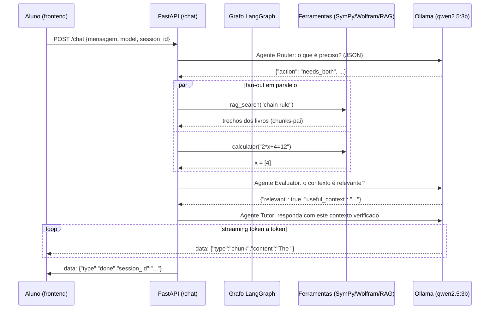

# 📖 Documento de Estudo — Todos os Conceitos da Doninha Matemática

> **Guia didático completo** dos conceitos, técnicas e tecnologias usados no projeto.
> Cada conceito indica **onde ele vive no código** e **por que ele existe**.
> Documento irmão do `relatorio_tecnico_doninha_matematica.md`.
> Data: 16/10/2026 · Commit de referência: `0249063`

---

## Como usar este documento

- **Trilha rápida** (1 dia): §§ 2, 4, 5, 7, 8 — entende a espinha dorsal do sistema.
- **Trilha de engenharia** (1 semana): tudo, com o código aberto ao lado.
- **Trilha de pesquisa** (§§ 9-11): RAG, grounding matemático, avaliação.
- Cada seção termina com **🛠️ Onde está no código** e, quando útil, **🧪 Exercício de estudo**.

---

## 📋 Índice

1. [O sistema em 1 minuto](#1-o-sistema-em-1-minuto)
2. [LLMs e SLMs — os fundamentos](#2-llms-e-slms--os-fundamentos)
3. [Ollama — rodando LLM local](#3-ollama--rodando-llm-local)
4. [Prompt Engineering](#4-prompt-engineering)
5. [Agentes de IA e arquitetura multi-agente](#5-agentes-de-ia-e-arquitetura-multi-agente)
6. [LangGraph — grafo de estados](#6-langgraph--grafo-de-estados)
7. [RAG — Retrieval-Augmented Generation](#7-rag--retrieval-augmented-generation)
8. [Grounding matemático — SymPy e Wolfram|Alpha](#8-grounding-matemático--sympy-e-wolframalpha)
9. [Backend web — FastAPI, REST e SSE](#9-backend-web--fastapi-rest-e-sse)
10. [Persistência — SQLAlchemy e SQLite](#10-persistência--sqlalchemy-e-sqlite)
11. [Frontend — SSE no navegador, KaTeX e sanitização](#11-frontend--sse-no-navegador-katex-e-sanitização)
12. [Infraestrutura local](#12-infraestrutura-local)
13. [Testes, experimentos e método científico](#13-testes-experimentos-e-método-científico)
14. [Glossário](#14-glossário)
15. [Mapa: conceito → arquivo → linha](#15-mapa-conceito--arquivo--linha)
16. [Roteiro de estudo sugerido](#16-roteiro-de-estudo-sugerido)

---

## 1. O sistema em 1 minuto

O aluno digita uma pergunta de matemática no navegador. O backend:



Três ideias sustentam tudo:

1. **O LLM não calcula — ele explica.** Toda conta exata é feita por SymPy/Wolfram (ferramentas determinísticas). O LLM recebe o resultado como "verdade verificada" e constrói a didática em cima disso. Isso se chama **grounding**.
2. **O trabalho é decomposto em agentes especializados** (Router, Evaluator, Tutor) — cada um com um prompt pequeno e focado, porque modelos pequenos (SLM de 3B) performam melhor com tarefas estreitas.
3. **O fluxo de controle é um grafo de estados**, não um `if/else` linear — permitindo paralelismo, ciclos de auto-correção e fallbacks encadeados.

---

## 2. LLMs e SLMs — os fundamentos

### 2.1 O que é um LLM

Um **Large Language Model** é uma rede neural (transformer) treinada para prever o próximo **token** de um texto. Conceitos que aparecem no projeto:

| Conceito | O que é | Onde aparece |
|---|---|---|
| **Token** | Unidade de texto (~4 caracteres em inglês, subpalavra). O modelo "pensa" em tokens, não em palavras | Latência e limites dependem de `num_predict` (contagem de tokens de saída) |
| **Context window** | Janela máxima de tokens (prompt + resposta) que o modelo "vê" de uma vez. Tudo o que não couber, não existe para o modelo | `backend.py` envia o histórico completo — funciona porque as sessões são curtas (limitação conhecida, §9.1 do relatório técnico) |
| **Temperatura** | 0 = determinístico; 1+ = criativo/aleatório. Amostragem do próximo token | Router/Evaluator: `temperature: 0.1` (decisões); rewrite: `0.3`; Tutor: padrão (criatividade didática) |
| **num_predict** | Máximo de tokens a gerar na resposta | Router: `150` (JSON curto); Evaluator: `500` |
| **Alucinação** | O modelo gera conteúdo plausível mas falso. Em matemática: derivação que "parece" certa e termina errada | Motivo de existir do projeto: por isso as contas vão para SymPy/Wolfram |
| **SLM** | Small Language Model — versões compactas (0.5B a 8B parâmetros). Rodam em CPU/máquinas comuns, mas erram mais em raciocínio | `qwen2.5:3b` (router/evaluator/tutor nos testes) e `deepseek-r1:1.5b` |
| **Efeito de recência** | LLMs prestam mais atenção ao **final** do prompt do que ao início | A "injeção de recência" do `tutor_node` (graph_agent.py:195-213) repete o resultado correto colado na última mensagem do usuário |

### 2.2 Por que modelos locais?

| Motivo | Consequência no projeto |
|---|---|
| **Privacidade** | Nada do aluno sai da máquina (exceto consultas opcionais ao Wolfram) |
| **Custo zero de API** | Sem cotas; pode rodar baterias de teste à vontade |
| **Controle** | Troca de modelo é uma string: `"model": "qwen2.5:3b"` |
| **Trade-off** | Modelos de 3B alucinam mais, seguem instruções pior, "esquecem" o meio do prompt — de onde vêm quase todas as limitações do sistema |

### 2.3 Prompt "sistema" vs "usuário" vs "assistente"

A conversa é uma lista de mensagens com papéis:

```python
[
  {"role": "system",    "content": "You are the Math Weasel (Doninha Matemática)..."},
  {"role": "user",      "content": "What is a derivative?"},
  {"role": "assistant", "content": "Great question! ..."}
]
```

- **system**: identidade e regras permanentes (o Tutor da Doninha vive aqui — `backend_tools.py:17-31`);
- **user**: o que o aluno diz;
- **assistant**: o que a Doninha respondeu (memória de conversa).

🛠️ **Onde está no código:** `system_instruction` (`backend_tools.py`), persistido como primeira mensagem de cada sessão (`backend.py:157-158`); histórico remontado a cada request (`backend.py:176-183`).

🧪 **Exercício:** suba o backend, faça 3 perguntas na mesma sessão e observe no terminal quantas mensagens o histórico tem. Depois responda: por que sessões longas degradam?

---

## 3. Ollama — rodando LLM local

**Ollama** é um runtime que baixa, serve e gerencia LLMs locais (como um "Docker para modelos"). O projeto usa via SDK Python (`ollama` 0.6.3).

### 3.1 Operações usadas

| Operação | Código | Uso |
|---|---|---|
| `ollama.list()` | `backend.py:83` | Lista modelos instalados → alimenta o seletor do frontend |
| `ollama.chat(model=..., messages=..., stream=False)` | `agents.py:99`, `158` | Chamada síncrona completa (Router/Evaluator precisam do JSON inteiro) |
| `ollama.chat(..., stream=True)` | `graph_agent.py:216` | Iterador de chunks — a resposta chega token a token |

### 3.2 Streaming e o formato dos chunks

Com `stream=True`, cada iteração devolve um objeto com `chunk.message.content`. O projeto tem um helper defensivo:

```python
def _get(obj, *keys, default=None):  # backend.py:57-66
    """Acesso seguro a dict ou objeto tipado."""
```

— porque versões antigas do SDK retornavam `dict` e as novas retornam objetos tipados. **Lição de engenharia:** escrever código tolerante a duas gerações de API.

### 3.3 Modelos instalados vs default do código

- Instalados: `qwen2.5:3b`, `deepseek-r1:1.5b`.
- Default no código: `llama3.2` (`ChatRequest.model`), com fallback `["llama3.2"]` se o Ollama estiver offline (`backend.py:91-94`). O frontend corrige isso carregando `/models` no boot (`app.js:229-254`) — mas é uma inconsistência a resolver.

🛠️ **Onde está no código:** `backend.py` (list/chat), `agents.py` (chamadas síncronas), `graph_agent.py` (streaming do tutor).

🧪 **Exercício:** rode `python graph_agent.py "solve 2x+3=7" deepseek-r1:1.5b --mermaid` e compare a latência com `qwen2.5:3b`. Rode também `ollama ps` durante a geração para ver o modelo residente em memória/GPU.

---

## 4. Prompt Engineering

### 4.1 O prompt do Tutor (system_instruction) — anatomia de um prompt de produto

`backend_tools.py:17-31`. Cada bloco tem uma função:

| Bloco | Texto (resumo) | Técnica aplicada |
|---|---|---|
| Identidade | "You are the Math Weasel (Doninha Matemática), an exceptional, didactic, patient, highly engaging math tutor" | Persona — orienta tom e estilo |
| Missão | "Your mission is NOT to be a simple calculator... You are a guide for mathematical thinking... the 'why' not just the 'how'" | Objetivo explícito — ancore o propósito |
| Regra crítica | "YOU MUST ALWAYS SPEAK IN ENGLISH... THIS IS A STRICT SYSTEM RULE" | Regra dura em caps. Motivo: o RAG traz livros em inglês e o modelo tende a derivar para o idioma do corpus ou do aluno |
| Regra 1 | Resolver completamente; **só** usar Sócrates se o aluno pedir passo a passo | **Socrático condicional** — a decisão de produto mais importante do prompt |
| Regras 2-4 | Contextualização real, acolhimento de erros, analogias antes do rigor | Pedagogia explicitada |
| Regra 5 | LaTeX obrigatório com `$...$`/`$$...$$`; proibido `\(`/`\[` | **Contrato de formato** com o frontend (KaTeX configurado exatamente para esses delimitadores) |
| Regra 6 | Encerrar com "Is this clear so far? What part would you like to explore more?" | Micro-engajamento pedagógico |

💡 **Lição:** prompts de produção não são "instruções soltas" — são contratos com o resto do sistema (formato LaTeX ↔ frontend, idioma ↔ corpus do RAG).

### 4.2 Classificação com JSON + few-shot

O Router (`agents.py:18-44`) pede classificação em 5 classes e dá **exemplos de saída** (few-shot):

```json
{"action": "chat_only"}
{"action": "needs_rag", "search_term": "definition of derivative"}
{"action": "needs_calc", "calc_expression": "2*x + 3 = 7"}
{"action": "needs_advanced", "wolfram_query": "integrate x^2 sin(x) dx"}
{"action": "needs_both", "search_term": "chain rule", "calc_expression": "3*x^2 + 2*x"}
```

Técnicas usadas: **few-shot examples**, **restrição de saída** ("you MUST respond with ONLY valid JSON"), **baixa temperatura** e **num_predict curto**.

### 4.3 Parsing defensivo de JSON — as 3 camadas

Modelos pequenos "enrolam": comentam antes, emitem dois JSONs, colocam cercas markdown. O `_parse_json_safe` (`agents.py:47-85`) responde com camadas:

```
1. json.loads(texto)                   → caso ideal
2. regex \{[^{}]*\} + merge            → JSONs embutidos: {"action":"needs_rag"}...{"action":"needs_calc"}
                                          → funde em {"action": "needs_both"}  ← genial!
3. substring keywords                  → "needs_rag" aparece no texto? adota a ação
4. default (chat_only)                 → nunca explode
```

Esse é um exemplo perfeito do princípio **"fail safe, não fail loud"** para sistemas de IA.

### 4.4 O prompt de reescrita de query (self-correction)

`graph_agent.py:156-159` — quando o RAG devolve algo irrelevante, outro prompt reformula a busca:

> "You rewrite search queries for a calculus textbook search engine... produce a better, more specific query using standard textbook terminology (in English). Respond ONLY with JSON: {"search_term": "..."}"

A ideia: a primeira busca foi feita com as palavras do aluno; a segunda, com o vocabulário do livro-texto. Isso explora o fato do embedding ser treinado em texto "acadêmico".

### 4.5 Injeção de contexto verificado (grounding no prompt)

`graph_agent.py:185-193` — o contexto aprovado é anexado ao system prompt:

```
[VERIFIED REFERENCE MATERIAL]
The following information was retrieved from tools and verified as relevant.
Use it to support your answer:
{trochos dos livros / resultados}
[END OF REFERENCE MATERIAL]
```

### 4.6 Injeção de recência (anti-alucinação específica para SLMs)

`graph_agent.py:195-213` — o trecho mais sutil do projeto:

```python
[VERIFIED COMPUTATION - computed by a symbolic math engine, it is CORRECT]
5*x - 15 = 35 => x = [10]
---
Your explanation MUST arrive at exactly this result.
Explain the steps that lead to it.
If your own derivation disagrees, your derivation has an error: fix it.
Write all math in LaTeX using $...$ and $$...$$.
```

**Por que funciona:** (a) fica **no fim** do prompt (efeito de recência); (b) afirma o resultado como **inegociável** ("it is CORRECT"); (c) dá uma instrução de resolução de conflito ("se discordar, o erro é seu"); (d) reforça o contrato LaTeX. É prompt engineering informado por arquitetura — o resultado que aparece ali não veio do LLM, veio do SymPy.

🛠️ **Onde está no código:** `backend_tools.py:17-31` (tutor), `agents.py:18-44,129-144` (router/evaluator), `graph_agent.py:156-159,185-213` (rewrite/grounding/recência).

🧪 **Exercício:** remova temporariamente a injeção de recência (comente o bloco) e refaça o TC-03 da bateria ("Solve 5*x - 15 = 35"). Compare se o Tutor ainda acerta a conta sozinho. Este é o experimento que comprova o valor do grounding.

---

## 5. Agentes de IA e arquitetura multi-agente

### 5.1 O que é um "agente" (neste projeto)

Um agente = **LLM + prompt especializado + papel no fluxo**. Não há ReAct com loop autônomo de Thought/Action/Observation; o projeto usa uma variante mais controlada e determinística: **tool-use orquestrado por grafo**. O LLM decide *o quê* (Router), o código decide *como* (grafo executa ferramentas), e o LLM narra *o resultado* (Tutor).

Comparação didática:

| Padrão | Como funciona | Neste projeto |
|---|---|---|
| **ReAct clássico** | LLM alterna pensamento/ação/observação em loop livre até concluir | ❌ não usado puro — loop livre é imprevisível para SLMs de 3B |
| **Tool calling nativo** | LLM emite chamadas de função estruturadas que o runtime executa | ❌ não usado (exigiria modelos maiores/mais alinhados) |
| **Roteamento + execução dirigida** | Uma chamada de classificação decide; o orquestrador (grafo) executa ferramentas fixas e injeta resultados | ✅ **é o padrão do projeto** |

### 5.2 Os três agentes

| Agente | Prompt | Entrada → Saída | Temp. |
|---|---|---|---|
| **Router** | 5 classes + extração de parâmetros | pergunta → `{action, search_term, calc_expression, wolfram_query}` | 0.1 |
| **Evaluator** | filtro de relevância | pergunta + contexto bruto → `{relevant, useful_context}` | 0.1 |
| **Tutor** | persona Doninha | histórico + contexto verificado → resposta streaming | padrão |
| *(bônus)* **Rewrite** | reescritor de busca | pergunta + query falha → `{search_term}` novo | 0.3 |

### 5.3 Por que multi-agente e não um prompt só?

| Problema do "prompt único" | Como a decomposição resolve |
|---|---|
| Um prompt que manda classificar + calcular + buscar + explicar confunde SLMs | Cada agente faz **uma coisa** — tarefa estreita = menos erro |
| Não dá para testar/debugar a "decisão" separada da "resposta" | A decisão do Router é um JSON auditável (a bateria E2E loga ela) |
| Contexto gigante no prompt final | O Evaluator **filtra** antes: o Tutor recebe só o que passou no crivo |
| Latência: tudo síncrono | RAG e cálculo podem rodar **em paralelo** (fan-out) |

🛠️ **Onde está no código:** `agents.py` (router/evaluator), `graph_agent.py` (rewrite/tutor e a orquestração).

---

## 6. LangGraph — grafo de estados

### 6.1 O que é

**LangGraph** modela um pipeline de LLM como uma **máquina de estados**: nós (funções Python) leem e atualizam um **estado compartilhado**; arestas (fixas ou condicionais) decidem o próximo nó. É a evolução estrutural do pipeline `if/else` — o fluxo vira **dado**, não código espalhado.

### 6.2 Estado tipado (`DoninhaState`)

`graph_agent.py:43-67` — um `TypedDict(total=False)`: todas as chaves opcionais. Contrato central do LangGraph:

> **Cada nó recebe o estado inteiro e devolve APENAS as chaves que quer alterar. O LangGraph faz o merge.**

```python
class DoninhaState(TypedDict, total=False):
    user_message: str          # entrada
    history: list[dict]
    model: str
    action: str                # decisão do router
    search_term: str
    calc_expression: str
    wolfram_query: str
    rag_result: str            # resultados das ferramentas (chaves separadas!)
    calc_result: str
    calc_failed: bool
    wolfram_result: str
    rag_retries: int
    rag_relevant: bool         # avaliação
    verified_context: str
    final_answer: str          # saída do tutor
```

💡 **Detalhe de ouro (comentado no código, linhas 38-41):** `rag_result` e `calc_result` são **chaves separadas** de propósito. Quando dois nós rodam em paralelo (fan-out) e ambos escrevem na mesma chave, o LangGraph acusaria conflito sem um *reducer* (função de combinação, ex.: `operator.add`). Chaves distintas = merge trivial.

### 6.3 Nós como funções puras

```python
def calc_node(state: DoninhaState) -> dict:
    expr = state.get("calc_expression", "")
    if not expr:
        return {"calc_result": "", "calc_failed": True}      # atualização parcial
    resultado = resolver_expressao_matematica(expr)
    if resultado.startswith("Erro"):
        return {"calc_result": "", "calc_failed": True}      # sinaliza fallback
    return {"calc_result": f"{expr} => {resultado}", "calc_failed": False}
```

Padrão: **função pura** (sem efeitos colaterais no estado global) que devolve *só o delta*. Isso torna cada nó testável isoladamente e o grafo determinístico dado o estado.

### 6.4 Arestas condicionais e roteamento como dado

```python
def route_after_router(state) -> list[str]:
    """Retornar uma LISTA de nós = executar todos em paralelo (fan-out)."""
    return {
        "needs_rag":      ["rag_search"],
        "needs_calc":     ["calculator"],
        "needs_advanced": ["wolfram"] if WOLFRAM_APP_ID else ["calculator"],
        "needs_both":     ["rag_search", "calculator"],
    }.get(state.get("action"), ["tutor"])   # default: chat_only → tutor
```

- **Lista = fan-out paralelo** (`needs_both` dispara RAG + calculadora ao mesmo tempo);
- **Default = tutor** (chat puro não paga custo de ferramenta);
- A ausência de `WOLFRAM_APP_ID` **rebaixa** `needs_advanced` para `calculator` — degradação graciosa configurada no roteador.

### 6.5 Fan-in com `defer=True`

O nó `evaluator` é declarado com `defer=True` (`graph_agent.py:272`). Sem isso, em `needs_both` os dois ramos chegam em momentos diferentes:

```
rag_search ──────────────► evaluator   (1 passo)
calculator → wolfram ────► evaluator   (2 passos, se SymPy falhar)
```

O LangGraph dispararia o `evaluator` (e depois o **tutor**) **duas vezes**. `defer=True` significa: *"só execute quando não houver mais nada pendente"* — é a barreira (join) do fan-in.

### 6.6 O ciclo de auto-correção

```
evaluator ──(irrelevante + retries < 1)──► rewrite_query ──► rag_search ──► evaluator ...
```

`route_after_evaluator` (`graph_agent.py:245-253`) fecha o ciclo. **Ciclos são o que um pipeline linear não faz de forma limpa:** aqui, "buscar de novo com outra query" é uma aresta, não um `while` aninhado com flags. O contador `rag_retries` (incrementado no `rewrite_query_node`) limita a 1 repetição — padrão `MAX_RAG_RETRIES`.

### 6.7 Fallback encadeado (SymPy → Wolfram)

```
calculator ──(calc_failed e tem WOLFRAM_APP_ID)──► wolfram ──► evaluator
           ──(ok)──────────────────────────────────► evaluator
```

O estado carrega o *porquê* da falha (`calc_failed: True`), não a decisão. O roteador condicional lê esse dado. Detalhe esperto (`wolfram_node:120-122`): se a consulta veio do fallback, usa a **expressão original** como query do Wolfram (já está em notação matemática); se veio direto de `needs_advanced`, usa a `wolfram_query` em inglês que o Router escreveu.

### 6.8 Streaming customizado

`stream_mode="custom"` + `get_stream_writer()`:

```python
def _status(message: str) -> None:
    get_stream_writer()({"type": "status", "message": message})   # eventos de etapa

# no tutor:
writer({"type": "chunk", "content": token})                       # tokens da resposta
```

Os nós publicam eventos estruturados; o backend converte 1:1 em SSE sem saber nada de LangGraph. **Desacoplamento em ação:** o grafo não conhece HTTP; o HTTP não conhece nós.

### 6.9 Visualização do grafo

`python graph_agent.py --mermaid` → `doninha_graph.get_graph().draw_mermaid()`. **Sempre desenhe seus grafos** — é o melhor diagrama de arquitetura possível, porque é gerado do código real.

🛠️ **Onde está no código:** `graph_agent.py` (arquivo inteiro, ~330 linhas — vale ler de cabo a rabo).

🧪 **Exercício:** adicione um nó `responder_em_portugues` ou mude `MAX_RAG_RETRIES = 2` e observe o comportamento no `--mermaid` e na bateria. Depois implemente um reducer (`Annotated[str, operator.add]`) em uma chave e force dois nós a escreverem nela para ver o conflito que o projeto evitou com chaves separadas.

---

## 7. RAG — Retrieval-Augmented Generation

### 7.1 O problema

O LLM não conhece os livros do aluno (Stewart, Simmons, Courant) e não pode "ver" 3.129 páginas no contexto. **RAG** = recuperar os trechos relevantes no momento da pergunta e injetá-los no prompt. Dois benefícios: **conhecimento atualizado/privado** + **citação de fatos** (reduz alucinação).

### 7.2 O pipeline de ingestão (offline, roda uma vez)

`rag/ingest.py`:

```
data/*.pdf (3.129 páginas)
   │  PyPDFDirectoryLoader — extrai texto página a página
   ▼
páginas (Document objects, com metadata "source" e "page")
   │  ParentDocumentRetriever.add_documents(batch de 100)  ← lote evita limite do ChromaDB
   ├──► splitter FILHO (400 chars, overlap 50)
   │        └► cada filho é VETORIZADO (all-MiniLM-L6-v2) e guardado no ChromaDB,
   │            carregando no metadata o id do pai
   └──► splitter PAI (2000 chars, overlap 200)
            └► o TEXTO do pai vai para o LocalFileStore (docstore chave-valor)
```

**Números reais deste projeto:** 24.907 chunks-filho vetorizados · 5.444 chunks-pai no docstore · índice de 140 MB.

### 7.3 Embeddings — como um texto vira vetor

**Embedding** = representação numérica do significado de um texto. O modelo `all-MiniLM-L6-v2` (384 dimensões, ~88 MB, roda em CPU via `sentence-transformers`) converte cada chunk-filho num vetor; o ChromaDB indexa esses vetores. Na busca, a pergunta vira vetor e o banco devolve os vetores mais **similares** (similaridade de cosseno — ângulo entre vetores, não distância absoluta).

Propriedade-chave: **similaridade semântica** — "instantaneous velocity" encontra um trecho que fala "rate of change of displacement with respect to time" mesmo sem compartilhar as palavras exatas.

### 7.4 Chunking — a decisão mais importante do RAG

O dilema clássico, documentado no experimento do próprio projeto (`comparativo_chunkers.md`):

| Estratégia | Como quebra | Prós | Contras |
|---|---|---|---|
| **Estático (baseline)** | A cada 1000 chars fixos, overlap 200 | Simples, previsível | Corta fórmulas ao meio; engole rodapés (`Copyright 2016 Cengage`); embedding "diluído" |
| **Semântico** | Onde o embedding detecta mudança de assunto (`SemanticChunker`, percentil 85) | Chunks coerentes | Tamanho imprevisível; pode gerar chunk minúsculo de 107 chars com "FIGURA 4" |
| **Parent-Child (adotado)** | Filho minúsculo p/ busca (400) + pai grande p/ contexto (2000) | **Melhor dos dois mundos** | Complexidade: 2 stores (vetores + docstore) |

**A intuição do Parent-Child (Small-to-Big):** o embedding de um chunk grande é "diluído" (32 assuntos num vetor = média confusa), mas o LLM precisa de contexto ao redor. Solução: **busca com o vetor do filho (cirúrgico), entrega o pai (contextual)**.

O experimento com corpus real mostrou por que o estático falha em matemática:

```
Original:  s = f(t) = t³ − 6t² + 9t
Extraído:  s − f std − t3 2 6t2 1 9t      ← assim que o PDF chega via pypdf
```

— o PDF de matemática corrompe `=` em `−`, `(t)` em `std` etc. O Parent-Child não conserta a extração, mas garante que a **seção inteira** (com o contexto que permite ao LLM reconstruir o sentido) chegue ao tutor.

### 7.5 A busca em tempo de pergunta

`rag/retriever.py`:

```python
retriever_cache = None                    # singleton: Chroma+embeddings carregam UMA vez

def buscar_contexto(pergunta, k=3):
    retriever = get_retriever()
    retriever.search_kwargs = {"k": k}    # top-3 chunks-pai
    resultados = retriever.invoke(pergunta)
    return "\n\n".join(f"- {doc.page_content}" for doc in resultados)
```

- **Singleton:** carregar o modelo de embeddings leva segundos e centenas de MB — fazer isso a cada pergunta seria inaceitável. (Correção já aplicada; a análise antiga apontava o problema.)
- **`k=3`:** quantos pais entregar ao Tutor. Trade-off: mais = mais contexto e mais tokens/latência; menos = risco de faltar o trecho certo.
- **Import tardio:** `rag_node` importa o retriever só quando executa (`graph_agent.py:92-93`) — evita carregar tudo só para desenhar o grafo com `--mermaid`.

### 7.6 O ciclo de correção do RAG no grafo

1. Router extrai `search_term` (em inglês, idealizado);
2. `rag_search` busca;
3. `evaluator` julga: o trecho responde à pergunta?
4. Se **não** e ainda há retry: `rewrite_query` reescreve com terminologia de livro-texto → volta ao passo 2;
5. Se sim (ou retries esgotados): contexto segue para o Tutor.

**Limitação observada nos testes:** o Evaluator de 3B aprovou um trecho sobre limites no infinito para uma pergunta sobre a definição formal de limite (TC-02) — o julgamento de relevância por SLM é grosseiro. Daí a recomendação de reranker cross-encoder.

🛠️ **Onde está no código:** `rag/ingest.py` (ingestão), `rag/retriever.py` (busca), `graph_agent.py:91-98,126-153` (nós), `laboratorio_chunkers.py` + `comparativo_chunkers.md` (o experimento), `agents.py:129-189` (o julgar da relevância).

🧪 **Exercícios:**
1. Rode `./venv/bin/python rag/ingest.py` de novo e note o tempo — por que a ingestão é offline e idempotente-por-aditividade?
2. Abra `db/chroma/chroma.sqlite3` (ou use `buscar_contexto` direto no REPL) com `k=1` vs `k=10` e compare a qualidade dos trechos para "chain rule".
3. Implemente o reranker cross-encoder descrito no relatório técnico (Fase C1) e meça a diferença no TC-02 e TC-06.

---

## 8. Grounding matemático — SymPy e Wolfram|Alpha

### 8.1 O princípio

> **LLMs escrevem texto plausível; motores simbólicos escrevem verdades.**

Um LLM pode "calcular" `∫ x·e^x dx` e errar o sinal; o SymPy devolve a forma exata; o Wolfram devolve `e^x(x−1)+C`. O padrão do projeto: **o LLM nunca é a fonte da verdade matemática** — ele é o **professor** que explica a verdade computada.

### 8.2 SymPy — CAS local

**CAS** (Computer Algebra System) = manipula expressões **simbólicas** (`x²`, `sin(x)`), não apenas números. O SymPy (biblioteca Python pura) é o motor padrão do projeto. API usada (`backend_tools.py:34-60`):

| Função | Papel | Exemplo |
|---|---|---|
| `sympify(str)` | Texto → expressão simbólica (o parser; mais seguro que `eval`) | `"2*x + 3"` → objeto SymPy |
| `Eq(a, b)` | Representa a equação `a = b` como objeto | `Eq(2*x+3, 7)` |
| `eq.free_symbols` | Quais incógnitas existem na equação | `{x}` |
| `solve(eq, x)` | Resolve simbolicamente | `[2]` |
| `expr.evalf()` | Avaliação numérica (float) | `sqrt(2)` → `1.4142...` |

**Normalizações de entrada** (a "cola" entre linguagem natural e matemática):

```python
expressao = expressao.replace('^', '**')                 # notação humana → Python
expressao = re.sub(r'(\d)([a-zA-Z])', r'\1*\2', expressao) # "2x" → "2*x" (multiplicação implícita)
```

**O bug pedagógico verificado:** `evalf()` aplicado sempre converte exatos em floats — `2+2` → `4.00000000000000`. Correção sugerida no relatório técnico (§9.2): só usar `evalf` quando o resultado exato não for apresentável.

**Segurança:** `sympify` é mais seguro que `eval`, mas não é um sandbox formal — um tema de estudo em si (execução de expressões vindas do modelo/usuário).

### 8.3 Wolfram|Alpha LLM API — a nuvem como segunda opinião

O projeto integra a **LLM API** do Wolfram (pensada para alimentar LLMs, não para humanos): `GET /api/v1/llm-api?input=...&appid=...&maxchars=4000`.

**Dois usos no grafo:**

1. **`needs_advanced`** (integrais, EDOs, matrizes...): vai direto ao Wolfram (o SymPy conseguiria em parte, mas o Wolfram é mais robusto);
2. **Fallback** quando o SymPy falha ao parsear (ex.: `15% of 240`, sintaxe natural).

**Engenharia de dados na resposta:** a API devolve texto com imagens, links e código Wolfram Language. O projeto limpa:

```python
_WOLFRAM_RUIDO = ("image:", "Wolfram Language code:", "Wolfram|Alpha website result",
                  "https://", "To use as", "(order n approximation")
```

— porque cada caractere de ruído consome contexto e pode confundir o Tutor. Trunca em 2.500 chars e degrada para `""` em qualquer falha (rede, 401, 501...). No `evaluator_node`, o resultado do Wolfram **não passa pelo Evaluator LLM** ("fonte computacional confiável") — entra direto no contexto verificado.

### 8.4 A hierarquia completa de confiança

```
cálculo simples/álgebra → SymPy (local, ms, exato)
        ↓ falhou?
cálculo avançado/falha  → Wolfram|Alpha (nuvem, ~s, robusto)
        ↓ indisponível?
                        → Tutor responde sozinho (e o prompt de recência não se aplica)
teoria                  → RAG (livros) → Evaluator (LLM julga — a fonte MENOS confiável, por isso é filtrada)
```

🛠️ **Onde está no código:** `backend_tools.py:34-60` (SymPy), `backend_tools.py:77-124` (Wolfram), `graph_agent.py:101-123` (nós), `test_wolfram.py` (testador cru).

🧪 **Exercício:** rode `./venv/bin/python test_wolfram.py` (precisa de `WOLFRAM_APP_ID` no `.env`) e observe latência vs qualidade das 8 consultas. Depois compare `resolver_expressao_matematica("integrate(x**2*sin(x), x)")` — o SymPy resolve? O que isso diz sobre a fronteira SymPy/Wolfram?

---

## 9. Backend web — FastAPI, REST e SSE

### 9.1 FastAPI — conceitos aplicados

| Conceito | No projeto |
|---|---|
| **Rotas decoradas** (`@app.get`, `@app.post`) | `/models`, `/sessions`, `/sessions/{id}/messages`, `/chat` |
| **Modelos Pydantic** (validação automática do corpo) | `class ChatRequest(BaseModel)` — `session_id`, `mensagem`, `model`. JSON inválido → HTTP 422 automático |
| **Dependency Injection** (`Depends`) | `get_db()` entrega uma `Session` SQLAlchemy e garante `close()` no fim (`backend.py:46-51`) |
| **Headers tipados** | `device_id: str = Header("unknown")` — o header `Device-ID` chega como parâmetro |
| **HTTPException** | 404 para sessão inexistente |
| **Middleware CORS** | `CORSMiddleware` com `allow_origins=["*"]` — necessário para arquivo local (`file://`) e ngrok |
| **StaticFiles** | `app.mount("/", StaticFiles(directory="frontend", html=True))` — a API também serve o site |
| **Lifespan/startup** | `models.Base.metadata.create_all(bind=engine)` + migração ALTER TABLE no import |

### 9.2 SSE — Server-Sent Events

**O que é:** um protocolo HTTP onde o servidor mantém a conexão aberta e envia eventos de texto no formato:

```
data: {"type":"chunk","content":"the "}

data: {"type":"chunk","content":"derivative "}

data: {"type":"done","session_id":"abc-123","modelo":"qwen2.5:3b"}
```

(linha `data: ...` + **linha vazia** = fim de um evento; `\n\n` no código).

**Por que SSE e não WebSocket?** O fluxo é **unidirecional** (servidor → cliente, token a token). SSE: simples, HTTP puro, reconexão nativa, funciona com proxies. WebSocket: bidirecional, mais complexo — desnecessário aqui.

**Implementação no FastAPI:** um **generator** Python vira `StreamingResponse`:

```python
def generate():
    for evento in graph_stream_events(...):
        yield f"data: {json.dumps(evento)}\n\n"

return StreamingResponse(generate(), media_type="text/event-stream", headers={
    "Cache-Control": "no-cache",
    "Connection": "keep-alive",
    "X-Accel-Buffering": "no",     # desliga buffering em proxies (Nginx)
})
```

**Detalhes de produção no código:**

- O generator abre **sessão de banco própria** (`SessionLocal()`) com `finally: db_gen.close()` — porque ele pode sobreviver ao ciclo de vida do request (client desconecta, stream continua);
- **Try/except dentro do generator**: erro vira evento `{"type":"error"}` em vez de derrubar a conexão (o cliente precisa do erro *no stream*);
- **Acumulação**: cada chunk é somado em `accumulated_content` para persistir a resposta final de uma vez ao final (não grava token a token no banco).

**Contrato de eventos** (frontend `switch` em `app.js:400-444` × backend): `status` → feedback de etapa; `chunk` → token de texto; `done` → encerra (com `session_id`); `error`. (+ `tool_use`: **existe só no frontend** — código morto, achado do relatório técnico.)

### 9.3 O endpoint `/chat` passo a passo

Leitura guiada de `backend.py:147-326`:

1. **Sessão**: cria ou valida `ChatSession` (UUID, `device_id`);
2. **Persistência da pergunta**: salva a mensagem do usuário **antes** de processar (garantia de não perder a pergunta);
3. **Histórico**: SELECT completo → lista de mensagens;
4. **Branch dual-engine** (`USE_LANGGRAPH`): delega ao grafo ou roda o pipeline manual;
5. **Streaming**: yield de eventos SSE;
6. **Persistência da resposta**: ao final, salva o texto acumulado como mensagem `assistant`.

🛠️ **Onde está no código:** `backend.py` (todo).

🧪 **Exercício:** use `curl` para ver a SSE crua:

```bash
curl -N -X POST http://127.0.0.1:8000/chat \
  -H "Content-Type: application/json" \
  -H "Device-ID: dev_test123" \
  -d '{"mensagem": "solve 2x+3=7", "model": "qwen2.5:3b"}'
```

`-N` desativa buffering do curl; observe os eventos chegando aos poucos. Depois remova `X-Accel-Buffering: no` e veja a diferença atrás de um proxy (se tiver um).

---

## 10. Persistência — SQLAlchemy e SQLite

### 10.1 ORM em 3 linhas

**ORM** (Object-Relational Mapping) = classes Python ↔ tabelas SQL. Em vez de escrever SQL, você manipula objetos:

```python
db.add(models.Message(session_id=sid, role="user", content="2x+3=7"))  # INSERT
db.commit()
sessao = db.query(models.ChatSession).filter(models.ChatSession.id == sid).first()  # SELECT
```

### 10.2 O que o projeto define

| Peça | Papel | Arquivo |
|---|---|---|
| `engine` | Conexão com o arquivo SQLite (`sqlite:///./doninha.db`); `check_same_thread=False` porque o stream SSE roda em outra thread | `db/database.py` |
| `SessionLocal` | Fábrica de sessões de banco (uma por request/stream) | idem |
| `Base` | Classe base declarativa dos modelos | idem |
| `ChatSession` | Sessão: id (UUID), `device_id` (indexado), `created_at` (UTC) | `db/models.py` |
| `Message` | Mensagem: id, FK `session_id`, role, content | idem |
| `relationship` + `cascade` | Navegação `session.messages`; deletar sessão apaga mensagens em cascata | idem |

### 10.3 Conceitos que aparecem

| Conceito | Explicação | Onde |
|---|---|---|
| **Foreign Key** | `messages.session_id → chat_sessions.id` — integridade referencial | `models.py:39` |
| **Index** | Acelera buscas por `device_id` e `id` | `models.py:23-24` |
| **UTC timezone-aware** | `datetime.now(timezone.utc)` — o correto (`utcnow` é deprecated e naive) | `models.py:16-17` |
| **Migração manual** | `ALTER TABLE ... ADD COLUMN` em try/except — a origem da coluna `device_id` em bancos antigos | `backend.py:27-32` |
| **N+1 queries** | Para cada sessão, uma query para achar a 1ª mensagem (título). OK em escala pequena; padrão clássico de otimização | `backend.py:104-116` |
| **Sessão vs Request vs Stream** | Três escopos diferentes de sessão de banco no mesmo fluxo | todo o backend |

### 10.4 SQLite — o banco de arquivo único

- Zero configuração, single-file (`doninha.db`), perfeito para local-first;
- Limitação: **um escritor por vez** (write lock global) — irrelevante para single-user;
- Evolução natural do projeto: PostgreSQL se virar multiusuário (como no roadmap antigo).

🛠️ **Onde está no código:** `db/database.py`, `db/models.py`, uso em `backend.py`.

🧪 **Exercício:** abra o banco e inspecione:

```bash
sqlite3 doninha.db ".tables" 
sqlite3 doninha.db "SELECT s.id, s.device_id, COUNT(m.id) FROM chat_sessions s LEFT JOIN messages m ON m.session_id = s.id GROUP BY s.id;"
```

Depois escreva o endpoint `DELETE /sessions/{id}` (referência no roadmap antigo, §8.5) e observe o cascade em ação.

---

## 11. Frontend — SSE no navegador, KaTeX e sanitização

### 11.1 Por que HTML/CSS/JS puro

Sem framework (React/Vue) por decisão de estudo: o DOM é manipulado direto (`document.createElement`, `innerHTML`, `addEventListener`). Arquivos: `index.html` (estrutura), `style.css` (design system em variáveis CSS), `app.js` (lógica).

### 11.2 Consumindo SSE com `fetch` (e por que não `EventSource`)

`EventSource` (API nativa de SSE) **só faz GET** — e o `/chat` é POST com corpo JSON. Solução: `fetch` + leitura manual do stream:

```javascript
const reader = response.body.getReader();
const decoder = new TextDecoder();
let buffer = '';

while (true) {
    const { done, value } = await reader.read();
    if (done) break;
    buffer += decoder.decode(value, { stream: true });
    const lines = buffer.split('\n');
    buffer = lines.pop() ?? '';        // guarda a linha incompleta p/ o próximo chunk
    for (const line of lines) {
        if (!line.startsWith('data: ')) continue;
        const data = JSON.parse(line.slice(6));
        switch (data.type) { /* chunk | status | done | error */ }
    }
}
```

Conceitos: **ReadableStream** (conexão como fluxo de bytes), **TextDecoder** (bytes UTF-8 → string), **buffer de linha** (um chunk de rede pode cortar um evento no meio — o `buffer` resolve isso; é o bug clássico de quem consome SSE manualmente).

### 11.3 O fluxo de renderização de uma resposta

```
token SSE → streamedContent += token
          → renderMarkdownAndMath(streamedContent)
              ├─ blocos <think> do DeepSeek → div estilizada
              ├─ sanitizeLatex()            ← normalização dos delimitadores
              ├─ marked.parse()             ← Markdown → HTML
              └─ renderMathInElement()      ← KaTeX: $...$ e $$...$$
          → contentDiv.innerHTML = resultado + cursor de streaming
```

**Achado do relatório técnico:** o re-render completo a cada token é O(n²) — aceitável para respostas curtas, otimizável (renderizar só o delta) para respostas longas.

### 11.4 `sanitizeLatex()` — por que existe (e por que é sofisticado)

Modelos pequenos **quebram o contrato LaTeX** de todas as formas: `\(...\)`, `\[...\]`, `$$` inline, comandos soltos sem delimitador (`\frac{1}{2}` fora de `$`). O KaTeX, por sua vez, só renderiza o que é delimitado. O `sanitizeLatex` (`app.js:38-129`) faz 5 passos:

1. Converte `\( \)` → `$ $` e `\[ \]` → `$$ $$` (notação alternativa);
2. Corrige `$$` usado como inline (sem quebra de linha em volta);
3. **Detecta comandos LaTeX órfãos** — varre a linha caractere a caractere, e ao achar `\frac` fora de `$`, captura a expressão com um **parser de chaves balanceadas** (`{`/`}` com contador `braceDepth`) e a envolve em `$...$`;
4. Ajusta espaçamento interno (`$ x+1 $` → `$x+1$`) sem engolir espaços externos;
5. Fecha `$` desbalanceado (contagem ímpar → adiciona um no fim).

É um **mini-compilador de tolerância** — a ponte entre a saída imperfeita do LLM e o renderizador rígido.

### 11.5 KaTeX, LaTeX, Markdown e XSS

| Conceito | Explicação | No projeto |
|---|---|---|
| **LaTeX** | Linguagem de notação matemática (`\frac{a}{b}`, `\int_0^1`) | Todo o formato de resposta do Tutor |
| **KaTeX** | Renderizador LaTeX para web, rápido, sem dependências | `vendor/katex/` **local** (offline) + `auto-render` para varrer o HTML |
| **`marked`** | Markdown (negrito, listas, código) → HTML | `vendor/marked.min.js` |
| **XSS** | Injeção de HTML/JS malicioso. `marked` faz *passthrough* de HTML cru por padrão — um modelo mal-comportado poderia injetar `` | `escapeHtml()` protege só as mensagens do **usuário**; resposta do modelo não é sanitizada (risco teórico, achado §9.14) |
| **localStorage** | Persistência no navegador (session_id, modelo, device_id) | `app.js:11-20` — o `device_id` identifica o "dono" do histórico sem login |
| **Debounce/throttle** | — | Não usado (auto-resize do textarea é direto; OK) |

### 11.6 UX de streaming

- Cursor piscante (`streaming-cursor`) enquanto gera; removido no `done`;
- **Status dos agentes** exibido no lugar da resposta enquanto não há tokens (`🔍 Analyzing your question...`, `🔍 Searching textbooks...`) — o aluno "vê" o pipeline trabalhando;
- Auto-scroll a cada chunk; atalhos (Enter envia, Shift+Enter quebra linha, `I` foca o input);
- Sidebar carrega em paralelo com os modelos (`Promise.all` no `init`).

🛠️ **Onde está no código:** `frontend/app.js` (530 linhas), `frontend/style.css`, `frontend/index.html`.

🧪 **Exercício:** abra o DevTools → Network → `/chat`, envie uma pergunta e inspecione o evento `EventStream`/resposta crua. Depois teste `sanitizeLatex` no console do navegador com entradas quebradas: `"o resultado é \\frac{1}{2} ok"`, `"\\(x^2\\)", "$$ x+1 $$ inline"`.

---

## 12. Infraestrutura local

### 12.1 O ambiente

| Peça | Papel | Detalhe do projeto |
|---|---|---|
| **venv** | Ambiente Python isolado | `venv/` (Python 3.14.7); o antigo `venv_windows_old/` (3.12) é resíduo |
| **requirements.txt** | Dependências com versões mínimas | 10 famílias de pacotes (§4 do relatório técnico) |
| **PyTorch CPU** | Backend do `sentence-transformers`/`transformers` | Instalado via `--index-url https://download.pytorch.org/whl/cpu` (sem GPU) |
| **Cache HuggingFace** | Modelos de embeddings baixados uma vez | `~/.cache/huggingface` (~88 MB) |
| **Ollama** | Runtime dos LLMs | v0.40.5; modelos em `/usr/share/ollama` ou home |
| **Uvicorn** | Servidor ASGI (async) | `./venv/bin/uvicorn backend:app --host 0.0.0.0 --port 8000` |
| **ngrok** | Túnel público p/ testar no celular | Comentado no código (`backend.py:328`) — o backend serve o frontend para facilitar |

### 12.2 `.env` sem python-dotenv

O projeto lê `.env` com um parser caseiro (`backend_tools.py:84-94`): procura `LINHA=valor`, remove quotes, aceita BOM (`utf-8-sig`). Chaves: `WOLFRAM_APP_ID` (usada) e `GEMINI_API_KEY` (**sem uso — resíduo de experimento**).

### 12.3 Conceitos de operação

- **CPU inference:** rodar 3B em CPU é viável para single-user (latências observadas de 6-30s);
- **Modelos quentes:** o primeiro request carrega o modelo na memória (mais lento); `ollama ps` mostra o que está residente;
- **Portas:** 8000 (app), 11434 (Ollama);
- **Privacidade por arquitetura:** só consultas de cálculo avançado saem da máquina (Wolfram); todo o resto roda local.

---

## 13. Testes, experimentos e método científico

### 13.1 Os três níveis de verificação do projeto

| Nível | Ferramenta | O que valida |
|---|---|---|
| **Unidade de ferramenta** | `test_wolfram.py` | A API externa responde? Quais códigos de erro existem? |
| **E2E de rotas** | `executar_bateria_testes.py` | Cada caminho do grafo executa e produz resposta? A rota real bate com a esperada? |
| **Experimento comparativo** | `laboratorio_chunkers.py` | Entre estratégias de chunking, qual recupera melhor? (com baseline!) |

### 13.2 O desenho experimental do laboratório de chunkers (vale estudar)

1. **Corpus controlado:** um trecho real de 14 KB do Stewart (`sample_text.txt`);
2. **Baseline explícito:** chunker estático 1000c (o padrão anterior);
3. **Variáveis independentes:** 3 estratégias de chunking;
4. **Métrica de recuperação:** as mesmas 3 queries conceituais em índices isolados;
5. **Métrica de qualidade:** o próprio Evaluator da Doninha julga cada trecho (juiz automatizado);
6. **Checagem de artefatos:** contaminação por rodapé (`Copyright 2016 Cengage`) — um tipo de *failure mode* catalogado;
7. **Documentação:** relatório MD gerado automaticamente com os trechos recuperados *inline* (auditável).

**Limitação honesta do experimento:** n=3 queries e 1 juiz (LLM de 3B). É um piloto — a evolução natural é o dataset de avaliação com métricas numéricas (precisão do router, taxa de aprovação do contexto, correção da resposta final) recomendado na Fase C3 do relatório técnico.

### 13.3 O que a bateria E2E revelou (e por que isso é valioso)

- 7/7 responderam; **2/7 desviaram da rota planejada** — e o relatório **registra o desvio**, não o esconde. A rota real (`stream_mode="updates"`) é a evidência primária;
- Cenários que "passam" mas revelam problemas: TC-02 (RAG aprovado com trecho tangencial), TC-05 (Tutor oscilou antes de aceitar o Wolfram), TC-06 (fan-out não exercitado).

**A lição de método:** um teste E2E que só checa "tem resposta?" esconde falhas de qualidade. Os melhores campos do relatório são exatamente os que expõem o processo: rota real, decisão do router, trecho recuperado, retries.

🛠️ **Onde está no código:** os três scripts + os três relatórios gerados.

🧪 **Exercício:** adicione um TC-08 à bateria ("calcule uma derivada avançada + conceito") e um campo `qualidade_esperada`; rode com `qwen2.5:3b` e `deepseek-r1:1.5b`; compare rotas, tempos e respostas.

---

## 14. Glossário

| Termo | Definição curta |
|---|---|
| **Agente** | LLM + prompt + papel em um fluxo (aqui: Router, Evaluator, Tutor, Rewrite) |
| **Aresta condicional** | No LangGraph, aresta cujo destino é decidido por função que lê o estado |
| **CAS** | Computer Algebra System — matemática simbólica exata (SymPy) |
| **Chunk** | Fragmento de documento indexado/selecionado pelo RAG |
| **Context window** | Janela máxima de tokens que o LLM processa de uma vez |
| **CORS** | Mecanismo do navegador que controla requisições cross-origin; wildcard `*` = libera geral |
| **defer (LangGraph)** | Nó que espera todos os ramos pendentes antes de rodar (barreira de fan-in) |
| **Docstore** | Armazenamento chave-valor dos chunks-pai (fora do vetor) |
| **Embedding** | Vetor numérico que representa o significado de um texto |
| **evalf()** | Avaliação numérica no SymPy (converte exato → float) |
| **Fan-out / Fan-in** | Abrir ramos paralelos / juntá-los (no projeto: `needs_both` + evaluator defer) |
| **Few-shot** | Dar exemplos no prompt para ensinar o formato desejado |
| **free_symbols** | Conjunto de variáveis livres de uma expressão SymPy |
| **Grounding** | Ancorar a resposta do LLM em fatos/resultados verificados externos |
| **Hallucination (alucinação)** | Conteúdo plausível e falso gerado pelo LLM |
| **LLM / SLM** | Large / Small Language Model |
| **LaTeX** | Notação tipográfica de matemática (`\frac`, `\int`, ...) |
| **Parent-Child** | Chunking Small-to-Big: busca pelo filho pequeno, entrega o pai grande |
| **Recência (efeito de)** | Viés do LLM de prestar mais atenção ao fim do prompt |
| **Reducer** | Função que combina atualizações concorrentes de uma chave de estado (LangGraph) |
| **ReAct** | Padrão de agente com loop Thought→Action→Observation |
| **RAG** | Retrieval-Augmented Generation: recuperar dados e injetá-los no prompt |
| **SSE** | Server-Sent Events: stream unidirecional servidor→cliente sobre HTTP |
| **StateGraph** | Grafo de estados do LangGraph (nós + arestas + estado tipado) |
| **System prompt** | Instruções permanentes de papel/regras do LLM |
| **Stateless** | Aqui: cada resposta à API é independente; sem estado entre chamadas |
| **Sympify** | Parser do SymPy: string → expressão simbólica |
| **Temperatura** | Parâmetros de aleatoriedade da amostragem de tokens |
| **Tool calling** | LLM emite chamadas de função que o runtime executa (aqui: orquestrado por grafo) |
| **Token** | Unidade atômica de texto para o LLM |
| **TypedDict** | Tipo do Python usado para o estado do grafo |
| **UTC aware** | Datetime com fuso explícito (prática correta em banco) |
| **Vector store** | Banco de vetores para busca por similaridade (ChromaDB) |
| **Venv** | Ambiente virtual Python isolado por projeto |

---

## 15. Mapa: conceito → arquivo → linha

| Conceito | Arquivo | Linhas |
|---|---|---|
| Prompt do Tutor (persona, Socratic conditional, LaTeX) | `backend_tools.py` | 17-31 |
| Ferramenta SymPy (normalização, Eq/solve, evalf) | `backend_tools.py` | 34-60 |
| Ferramenta RAG (wrapper) | `backend_tools.py` | 63-72 |
| Cliente Wolfram + limpeza de ruído + `_ler_env` | `backend_tools.py` | 77-124 |
| Prompt do Router + few-shot JSON | `agents.py` | 18-44 |
| Parser JSON em 3 camadas + merge needs_both | `agents.py` | 47-85 |
| Router (chamada Ollama, temp 0.1) | `agents.py` | 88-122 |
| Prompt do Evaluator | `agents.py` | 129-144 |
| Evaluator (fallback de relevância) | `agents.py` | 147-189 |
| Estado tipado (chaves separadas p/ fan-out) | `graph_agent.py` | 43-67 |
| Eventos de status (stream writer) | `graph_agent.py` | 70-72 |
| Nós: router, rag, calc, wolfram | `graph_agent.py` | 79-123 |
| Evaluator (SymPy/Wolfram confiáveis direto) | `graph_agent.py` | 126-153 |
| Prompt + nó de reescrita de query | `graph_agent.py` | 156-177 |
| Tutor: grounding + **injeção de recência** + streaming | `graph_agent.py` | 180-221 |
| Arestas condicionais (fan-out, fallback, ciclo) | `graph_agent.py` | 228-253 |
| Montagem do grafo + `defer=True` + ciclo | `graph_agent.py` | 260-291 |
| `stream_events` (custom stream mode) | `graph_agent.py` | 297-305 |
| CLI didático (`--mermaid`) | `graph_agent.py` | 311-331 |
| Dual-engine (`USE_LANGGRAPH`) | `backend.py` | 18-21 |
| Migração ALTER TABLE | `backend.py` | 27-32 |
| `/models` + helper `_get` (dict/objeto) | `backend.py` | 57-94 |
| Sessões + títulos | `backend.py` | 97-142 |
| `/chat`: sessão, persistência, histórico | `backend.py` | 147-183 |
| Generator SSE + acumulação + persistência final | `backend.py` | 186-316 |
| Headers SSE (`X-Accel-Buffering`) | `backend.py` | 318-326 |
| StaticFiles do frontend | `backend.py` | 329 |
| Ingestão Parent-Child + batching 100 | `rag/ingest.py` | 36-76 |
| Singleton do retriever + `buscar_contexto(k=3)` | `rag/retriever.py` | 14-76 |
| Engine SQLite + `check_same_thread` | `db/database.py` | 11-16 |
| Modelos ORM + cascade + UTC | `db/models.py` | 16-43 |
| `sanitizeLatex` (5 etapas, comandos órfãos) | `frontend/app.js` | 38-129 |
| Markdown + KaTeX + `<think>` blocks | `frontend/app.js` | 131-160 |
| Cliente SSE manual (reader/buffer) | `frontend/app.js` | 386-446 |
| device_id / localStorage / sessões | `frontend/app.js` | 11-20, 278-340 |
| Design system (variáveis CSS, tema terminal) | `frontend/style.css` | 1-21 |
| KaTeX/marked locais (offline) | `frontend/index.html` | 18-24 |
| Bateria E2E (7 cenários + relatório) | `executar_bateria_testes.py` | 27-240 |
| Experimento de chunking | `laboratorio_chunkers.py` | 56-259 |
| Testador Wolfram (bateria + interativo) | `test_wolfram.py` | 25-104 |

---

## 16. Roteiro de estudo sugerido

### Trilha 1 — Fundamentos (1-2 dias)

1. Leia `README.md` + §1-2 deste documento;
2. Suba o sistema (`uvicorn`) e converse com ele — pergunte um conceito, uma conta e um "oi";
3. Observe o terminal do backend: cada print conta a história do pipeline (`[AGENTE 1 - ROUTER]`, `[FERRAMENTA EXECUTADA]`, `[DONINHA]`);
4. Leia `agents.py` inteiro (189 linhas).

**Checkpoint:** explique com suas palavras por que o Router e o Evaluator rodam com `temperature=0.1` e o Tutor não.

### Trilha 2 — Orquestração (3-5 dias)

1. Leia `graph_agent.py` de cabo a rabo (com este documento aberto no §6);
2. `python graph_agent.py --mermaid` e desenhe o grafo à mão;
3. Rode a bateria E2E (`./venv/bin/python executar_bateria_testes.py`) e leia o relatório gerado;
4. Modifique: `MAX_RAG_RETRIES = 3`, crie um nó novo, force um conflito de chave de estado (experimento do reducer);
5. Compare `USE_LANGGRAPH=1` vs `0` na mesma pergunta — documente as diferenças (existe uma divergência real em `needs_advanced`).

**Checkpoint:** por que `rag_result` e `calc_result` são chaves separadas? O que aconteceria se ambos escrevessem em `resultado`?

### Trilha 3 — RAG (3-5 dias)

1. Leia `rag/ingest.py` e `rag/retriever.py` (157 linhas juntos);
2. Rode `laboratorio_chunkers.py` e estude `comparativo_chunkers.md`;
3. No REPL, chame `buscar_contexto` com perguntas suas; mude `k` e avalie;
4. Implemente o reranker cross-encoder (esqueleto no relatório técnico §10/Fase C1);
5. **Projeto sugerido:** adicionar metadata (livro + página) ao contexto entregue ao Tutor, para que ele possa citar `[Stewart, p. 169]`.

**Checkpoint:** por que o embedding do chunk-pai "dilui" a similaridade? O que o Parent-Child resolve e o que **não** resolve (dica: extração do PDF)?

### Trilha 4 — Grounding matemático (2-3 dias)

1. Leia `backend_tools.py`;
2. Explore o SymPy no REPL: `sympify`, `solve`, `Eq`, `evalf`, `N`;
3. Corrija o bug do `evalf` (Fase A2 do relatório) e escreva um mini-testador com 10 expressões (inteiras, fracionárias, irracionais, equações);
4. Rode `test_wolfram.py` e compare SymPy vs Wolfram nas mesmas 8 consultas.

**Checkpoint:** onde exatamente o LLM "decide" e onde ele "narra" no fluxo de cálculo? Desenhe a fronteira.

### Trilha 5 — Produto completo (1-2 semanas)

1. Implemente as Fases A e B do relatório técnico (context window, delete de sessão, healthcheck, logging);
2. Escreva os testes `pytest` (os 4 casos de `_parse_json_safe` estão no roadmap antigo, §10.3);
3. Monte o dataset de avaliação (30-100 casos) e meça: precisão do Router, taxa de aprovação do contexto, presença do resultado correto na resposta final;
4. Documente cada mudança num relatório novo — mantenha o método do projeto.

---

## Leituras recomendadas (para aprofundar)

| Tema | Referência |
|---|---|
| LLMs e prompts | Documentação do Ollama + "Prompt Engineering Guide" (DAIR.AI) |
| LangGraph | Documentação oficial (conceitos: StateGraph, conditional edges, deferred nodes, streaming) |
| RAG | Artigo original de Lewis et al. (2020); livros-texto do LangChain sobre retrievers; paper do Parent-Child via LangChain docs |
| Embeddings | Sentence-Transformers docs; paper do `all-MiniLM` (sentence-transformers) |
| Matemática simbólica | SymPy docs (tutorial de `solve`, `simplify`, `evalf`); Wolfram\|Alpha LLM API docs |
| SSE | MDN "Server-sent events" + FastAPI docs de `StreamingResponse` |
| SSE no navegador | MDN "Using readable streams" |
| KaTeX | katex.org/docs + auto-render extension |
| FastAPI | Tutorial oficial (Dependencies, StreamingResponse, StaticFiles) |
| SQLAlchemy | ORM Quick Start + conceitos de session/engine |
| Avaliação de IA | "Evaluating LLM applications" (LangSmith docs) — para o dataset de avaliação |

---

> 🦡 **Fim do documento.** Este guia foi escrito para ser lido **com o código aberto ao lado** — cada seção aponta arquivo e linha. Combine com `relatorio_tecnico_doninha_matematica.md` (estado atual + problemas + recomendações) e com os relatórios de experimento do próprio projeto (`comparativo_chunkers.md`, `relatorio_testes_fluxo.md`), que são exemplos vivos do método de estudo adotado: **implementar → medir → documentar → melhorar**.
