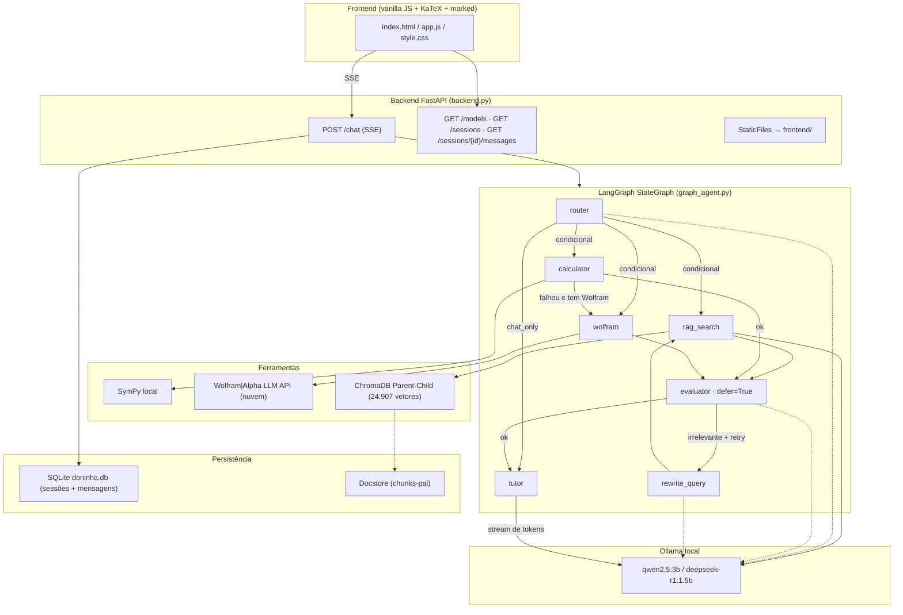

# 🦡 Relatório Técnico Completo — Doninha Matemática

> **Análise integral do projeto** — arquitetura, componentes, dados, testes, problemas e recomendações.
> Documento gerado em **16/10/2026** a partir da inspeção direta do código-fonte, banco de dados, índice vetorial e ambiente de execução.
> Commit analisado: `0249063` ("Adiciona cache busting v2 e padding para formulas LaTeX") — branch `main`.

---

## 📋 Índice

1. [Resumo Executivo](#1-resumo-executivo)
2. [Propósito e Contexto do Projeto](#2-propósito-e-contexto-do-projeto)
3. [Inventário Completo do Projeto](#3-inventário-completo-do-projeto)
4. [Stack Tecnológico (versões reais instaladas)](#4-stack-tecnológico-versões-reais-instaladas)
5. [Arquitetura Atual](#5-arquitetura-atual)
6. [Componentes em Detalhe](#6-componentes-em-detalhe)
7. [Fluxos de Ponta a Ponta Validados](#7-fluxos-de-ponta-a-ponta-validados)
8. [Análise Crítica por Componente](#8-análise-crítica-por-componente)
9. [Problemas e Riscos Identificados](#9-problemas-e-riscos-identificados)
10. [Recomendações Priorizadas](#10-recomendações-priorizadas)
11. [Métricas e Números do Projeto](#11-métricas-e-números-do-projeto)
12. [Estado dos Artefatos de Estudo](#12-estado-dos-artefatos-de-estudo)
13. [Conclusão](#13-conclusão)

---

## 1. Resumo Executivo

A **Doninha Matemática** é um projeto de estudo que implementa um **tutor de matemática com IA local**, combinando quatro pilares técnicos:

1. **Orquestração multi-agente em grafo de estados** (LangGraph `StateGraph`) com Router, Evaluator, Tutor e ciclo de auto-correção de busca;
2. **Grounding com motores exatos** — SymPy (local) e Wolfram|Alpha (nuvem) — para eliminar alucinação matemática;
3. **RAG Parent-Child (Small-to-Big)** sobre três livros-texto de Cálculo ingeridos em ChromaDB (**24.907 embeddings** de chunks-filho sobre 3.129 páginas de PDF);
4. **Interface web estilo terminal** com streaming SSE token-a-token e renderização LaTeX via KaTeX.

**Estado geral:** o projeto está **funcional e maduro para um ambiente de estudo** — o pipeline completo (7 rotas de grafo) foi validado E2E com o modelo `qwen2.5:3b`, com tempos entre 6,5s e 29s por resposta. O ponto mais forte é a **resiliência em camadas**: todos os agentes têm fallbacks, o cálculo tem fallback SymPy → Wolfram, e nenhum erro derruba o sistema.

**Principal lacuna técnica:** não há **gerenciamento de janela de contexto** — o histórico completo da sessão é reenviado ao modelo a cada mensagem, o que degrada sessões longas (crítico para SLMs de 3B). Esse problema já havia sido apontado na análise anterior (`analise_completa_doninha_matematica.md`) e **permanece em aberto**.

**Destaques deste relatório (achados novos, verificados em execução):**

- 🐛 `resolver_expressao_matematica("2+2")` retorna `4.00000000000000` — o uso incondicional de `.evalf()` contamina resultados exatos com notação de ponto flutuante;
- 🐛 `"15% of 240"` (exemplo dado no próprio prompt do Router!) **falha** no SymPy — o prompt promete o que a ferramenta não entrega;
- ⚠️ O evento SSE `tool_use` existe no frontend mas **nunca é emitido** pelo backend — código morto;
- ⚠️ O pipeline manual legado (com `USE_LANGGRAPH=0`) **não trata `needs_advanced`** — recurso existe só no grafo;
- ⚠️ Nos testes E2E registrados, 2 de 7 casos **desviaram da rota esperada** (o Router de 3B classificou mal requisições compostas) — evidência prática da limitação de SLMs no roteamento;
- 🧹 Resíduos de migração Windows → Linux: `venv_windows_old/` (1,4 GB), `__pycache__` com bytecodes cpython-312 e cpython-314 misturados, `db/chroma_vazio_backup/`, `GEMINI_API_KEY` no `.env` sem nenhum uso no código.

---

## 2. Propósito e Contexto do Projeto

O README define o objetivo com clareza:

> "Simular o produto da Doninha Matemática, onde um modelo de linguagem guia o aluno **socraticamente**, em vez de apenas dar a resposta final. [...] o foco está na utilização de **Modelos Locais (SLMs/LLMs)**, garantindo privacidade total, controle da infraestrutura e isenção de limites de cota ou custos de APIs de terceiros."

Características do contexto de desenvolvimento (por observação do histórico e artefatos):

| Aspecto | Observação |
|---|---|
| Natureza | Projeto de **estudo iterativo** — evolução visível por marcos: pipeline manual → pipeline multi-agente → LangGraph → RAG Parent-Child → fallback Wolfram |
| Estratégia | Cada iteração deixa **um relatório de experimento** (comparativo de chunkers, bateria E2E, roadmaps) — método quase científico, com baseline e comparativo |
| Migração | Projeto nasceu no Windows (caminhos `c:/Users/muril/...` nos docs antigos), foi restaurado no Linux (`models.py` e `database.py` foram **reconstruídos a partir de bytecode** `.pyc`) |
| Hardware/infra | Ollama local v0.40.5 com `qwen2.5:3b` (1,9 GB) e `deepseek-r1:1.5b` (1,1 GB); PyTorch CPU-only; embeddings via `sentence-transformers` |
| Escopo atual | Single-user, local-first, sem autenticação — adequado ao estágio |

---

## 3. Inventário Completo do Projeto

### 3.1 Estrutura de arquivos (raiz)

| Arquivo | Linhas | Papel |
|---|---:|---|
| `backend.py` | 329 | Servidor FastAPI: endpoints REST, SSE de chat, dual-engine (LangGraph/manual), migração SQL automática, serve o frontend |
| `graph_agent.py` | 331 | Pipeline LangGraph: estado tipado, 7 nós, arestas condicionais, fan-out/fan-in, ciclo de re-escrita, fallback SymPy→Wolfram |
| `agents.py` | 189 | Agente Router (classificação JSON) e agente Evaluator (filtro de relevância) + parser JSON robusto de 3 camadas |
| `backend_tools.py` | 124 | System prompt do Tutor, ferramenta SymPy, ferramenta de busca RAG, cliente Wolfram\|Alpha LLM API |
| `executar_bateria_testes.py` | 240 | Bateria E2E de 7 cenários do grafo → gera `relatorio_testes_fluxo.md` |
| `laboratorio_chunkers.py` | 259 | Experimento comparativo de 3 estratégias de chunking → gera `comparativo_chunkers.md` |
| `test_wolfram.py` | 105 | Teste cru da API Wolfram (bateria, consulta única, modo interativo) |
| `test_llm.py` | 43 | ⚠️ **Desatualizado** — espera resposta JSON síncrona (`dados.get('resposta')`), mas o backend agora usa SSE |
| `sample_text.txt` | — | Trecho real do Stewart Calculus (14 KB) usado como corpus do laboratório de chunkers |
| `requirements.txt` | 32 | Dependências com versões mínimas |
| `README.md` | 42 | Instalação, uso, visão geral da arquitetura |
| `.env` | 3 | `GEMINI_API_KEY` (**sem uso no código**) e `WOLFRAM_APP_ID` (usado) |
| `.gitignore` | 15 | Exclui venvs, `.env`, PDFs (direitos autorais), banco e índices |
| `doninha.db` | 52 KB | SQLite com 6 sessões e 20 mensagens |
| `analise_completa_doninha_matematica.md` | 1288 | Análise anterior + roadmap de melhorias (referência histórica) |
| `comparativo_chunkers.md` | 316 | Relatório do experimento de chunking (gerado pelo lab) |
| `relatorio_testes_fluxo.md` | 614 | Relatório da bateria E2E de 09/10/2026 (gerado pela bateria) |
| `DxDiag.txt` | — | Arquivo pessoal do Windows (ignorado pelo git) |

### 3.2 Pacotes e diretórios

| Caminho | Conteúdo | Tamanho |
|---|---|---:|
| `db/` | `database.py` (engine SQLite), `models.py` (ORM), `__init__.py` | 161 MB (com índices) |
| `db/chroma/` | ChromaDB: `chroma.sqlite3` (98 MB) + segmento vetorial (42 MB) — **24.907 embeddings** na collection `parent_child_splits` | ← |
| `db/docstore/` | Docstore em arquivos (pares chave-valor do ParentDocumentRetriever) — **5.444 arquivos** (chunks-pai serializados) | 22 MB |
| `db/chroma_vazio_backup/` | 🧹 Backup vazio da era pré-Parent-Child (candidato a remoção) | — |
| `rag/` | `ingest.py` (ingestão), `retriever.py` (busca com singleton em cache) | 20 KB |
| `frontend/` | `index.html` (99), `app.js` (530), `style.css` (540), `vendor/` (KaTeX completo + `marked.min.js`) | 3,1 MB |
| `data/` | 3 PDFs de Cálculo: Stewart (1457 pág.), Simmons (986 pág.), Courant (686 pág.) = **3.129 páginas** | 137 MB |
| `venv/` | Ambiente atual — **Python 3.14.7** | 1,8 GB |
| `venv_windows_old/` | 🧹 Venv da era Windows (bytecode 3.12) — candidato a remoção | 1,4 GB |
| `__pycache__/` | 🧹 Bytecodes mistos cpython-312 (Windows) e cpython-314 (Linux) | 132 KB |
| `frontend/vendor/katex/` | KaTeX local (CSS, JS, contribs) — permite renderização offline | (incluso em 3,1 MB) |

---

## 4. Stack Tecnológico (versões reais instaladas)

### 4.1 Ambiente Python (`venv`, Python 3.14.7)

| Camada | Pacote | Versão instalada |
|---|---|---|
| API | `fastapi` | 0.143.2 |
| Servidor | `uvicorn[standard]` | 0.54.0 |
| Validação | `pydantic` | 2.14.1 |
| HTTP client | `httpx` | 0.28.1 |
| ORM | `SQLAlchemy` | 2.1.4 |
| LLM local | `ollama` (python) | 0.6.3 |
| Matemática simbólica | `sympy` | 1.14.0 |
| Orquestração | `langgraph` | 1.2.15 |
| Ecossistema RAG | `langchain` 1.4.6 · `langchain-core` 1.6.11 · `langchain-classic` 1.0.8 · `langchain-community` 0.4.2 · `langchain-text-splitters` 1.1.3 · `langchain-chroma` 1.1.0 · `langchain-huggingface` 1.2.3 · `langchain-experimental` 0.4.2 | — |
| Vector DB | `chromadb` | 1.5.9 |
| Embeddings | `sentence-transformers` 6.1.0 · `transformers` 5.20.1 · `torch` 2.14.1+cpu | — |
| PDF | `pypdf` | 6.21.0 |

### 4.2 Runtime de LLM

| Item | Valor |
|---|---|
| Ollama | v0.40.5 (`/usr/local/bin/ollama`) |
| Modelos instalados | `qwen2.5:3b` (1,9 GB) · `deepseek-r1:1.5b` (1,1 GB) |
| Modelo padrão dos testes | `qwen2.5:3b` |
| Embedding model | `all-MiniLM-L6-v2` (384 dims, ~88 MB em cache HF local) |
| Prompt default da API | `llama3.2` (fallback se Ollama não listar modelos) |

> **Nota:** o venv usa Python **3.14.7** — muito recente. O bytecode legado era 3.12 (Windows). Rodar em versão tão nova funciona hoje, mas é um fator de risco de compatibilidade para futuras dependências (ex.: wheels nativos).

---

## 5. Arquitetura Atual

### 5.1 Diagrama geral



### 5.2 Decisão arquitetural central: dual-engine

O `backend.py` decide no startup qual motor usar (`backend.py:18-21`):

```python
USE_LANGGRAPH = os.getenv("USE_LANGGRAPH", "1") != "0"
```

- **`USE_LANGGRAPH=1` (padrão):** o endpoint delega ao grafo (`graph_stream_events`), que emite eventos `status` e `chunk` via `get_stream_writer()`.
- **`USE_LANGGRAPH=0`:** o pipeline manual legado executa Router → ferramentas → Evaluator → Tutor com `if/else` dentro do próprio endpoint (mantido "para comparação" — comentário explícito no código).

Essa dualidade é intencional (didática), mas cria **dois caminhos de código com lógica quase duplicada** (injeção de contexto no system prompt, streaming, persistência) que podem divergir. Já divergem: o motor manual não trata `needs_advanced`.

---

## 6. Componentes em Detalhe

### 6.1 `backend.py` — Servidor FastAPI

**Endpoints:**

| Rota | Método | Descrição | Linhas |
|---|---|---|---|
| `/models` | GET | Lista modelos Ollama (com fallback `["llama3.2"]` se offline); trata dict e objeto tipado via helper `_get()` | 79-94 |
| `/sessions` | GET | Lista sessões do `Device-ID` do header, mais recentes primeiro; título = primeiros 60 chars da 1ª mensagem do usuário | 97-123 |
| `/sessions/{id}/messages` | GET | Mensagens `user`/`assistant` da sessão (exclui system) | 126-142 |
| `/chat` | POST | Pipeline completo com SSE streaming | 147-326 |
| `/` | MOUNT | Serve `frontend/` estaticamente (facilita acesso via ngrok) | 329 |

**Fluxo do `/chat`:**

1. **Sessão** (`153-164`): cria `ChatSession` com UUID se não houver `session_id`; grava o system prompt como primeira mensagem; valida existência se houver.
2. **Persistência imediata** (`166-174`): a mensagem do usuário é salva **antes** do processamento — se o pipeline falhar, a pergunta fica no histórico sem resposta.
3. **Histórico** (`176-183`): carrega **todas** as mensagens da sessão → `historico` (aqui está o problema do contexto, ver §9.1).
4. **Generator SSE** (`186-316`): abre uma **sessão de banco própria** (`SessionLocal()`) porque o generator roda fora do escopo da dependency do request. No modo LangGraph, acumula os chunks, persiste a resposta do assistente e emite `done` com `session_id`.
5. **Headers SSE** (`318-326`): `text/event-stream`, `Cache-Control: no-cache`, `X-Accel-Buffering: no` (evita buffering por Nginx).

**Protocolo de eventos (contrato front↔back):** `{type: "status" | "chunk" | "done" | "error", ...}` serializados como `data: {...}\n\n`.

**Migração automática** (`27-32`): `ALTER TABLE chat_sessions ADD COLUMN device_id ...` dentro de `try/except: pass`. Funciona, mas é frágil e silenciosa (qualquer erro é engolido).

### 6.2 `graph_agent.py` — O grafo LangGraph

**Estado tipado** (`DoninhaState`, `43-67`): `TypedDict(total=False)` com 18 chaves em 5 grupos (entrada, decisão do router, resultados das ferramentas, avaliação, resposta final). Decisão de design importante e comentada no código: `rag_result` e `calc_result` são **chaves separadas** porque os nós paralelos (fan-out) escrevem ao mesmo tempo — sem reducer, escrever na mesma chave causaria conflito.

**Nós (8):**

| Nó | Papel | Detalhes |
|---|---|---|
| `router` | Classifica a intenção | Chama `router_agent`; inicializa `rag_retries=0` |
| `rag_search` | Busca nos livros | Import tardio do retriever (evita carregar Chroma/embeddings só para desenhar o grafo) |
| `calculator` | SymPy | Falha → `calc_failed=True` (aciona fallback) |
| `wolfram` | Wolfram\|Alpha | Se veio de fallback do SymPy, usa a expressão original como consulta |
| `evaluator` | Consolida contexto | `defer=True`: só roda **quando todos os ramos paralelos terminam**. RAG passa pelo LLM (julgamento de relevância); **SymPy e Wolfram entram direto, sem LLM** ("fontes computacionais confiáveis") |
| `rewrite_query` | Reformula busca | LLM re-escreve o termo em terminologia de livro-texto; incrementa `rag_retries` |
| `tutor` | Resposta final | Streaming token a token via `get_stream_writer()` + injeção de contexto verificado + **injeção de recência** (ver abaixo) |

**Injeção de recência** (`195-213`) — uma das partes mais interessantes do projeto:

> "Modelos pequenos 'esquecem' o contexto que fica no topo do system prompt e refazem a conta sozinhos (errando). Repetimos o resultado computado **colado na última mensagem do usuário** (efeito de recência)."

O resultado do motor simbólico é re-afirmado como "CORRECT" na última mensagem, com a instrução: *"Sua explicação DEVE chegar exatamente a este resultado... se sua derivação discordar, sua derivação tem um erro: corrija."*

**Arestas condicionais:**

| Função | Decisão |
|---|---|
| `route_after_router` | Mapeia action → lista de nós (lista = fan-out paralelo). `needs_advanced` → `wolfram` se `WOLFRAM_APP_ID` configurado, senão `calculator` |
| `route_after_calculator` | `calc_failed` + Wolfram disponível → `wolfram`; senão → `evaluator` |
| `route_after_evaluator` | RAG irrelevante + action pediu RAG + `retries < MAX_RAG_RETRIES (1)` → `rewrite_query`; senão → `tutor` |

**Montagem** (`260-291`): `START → router`; fan-in no `evaluator`; ciclo `rewrite_query → rag_search`; `tutor → END`. O `defer=True` é justificado em comentário: sem ele, com ramos de tamanhos diferentes (`rag` = 1 passo; `calc → wolfram` = 2 passos), o evaluator (e o tutor!) rodariam duas vezes.

**Streaming** (`297-305`): `doninha_graph.stream(estado_inicial, stream_mode="custom")` — os nós publicam eventos via `get_stream_writer()`; o backend converte 1:1 em SSE.

**CLI embutido** (`311-331`): `python graph_agent.py [pergunta] [modelo]` e `--mermaid` (imprime o diagrama do grafo) — ótimo artefato de estudo.

### 6.3 `agents.py` — Router e Evaluator

**Router** (agente 1): classifica em 5 classes — `chat_only`, `needs_rag`, `needs_calc`, `needs_advanced`, `needs_both` — com `temperature=0.1` e `num_predict=150` (rápido/determinístico), devolvendo JSON puro com campos de extração (`search_term`, `calc_expression`, `wolfram_query`).

**`_parse_json_safe`** — parser resiliente de 3 camadas (boa prática demonstrada):

1. `json.loads` direto;
2. regex `\{[^{}]*\}` para extrair objetos embutidos no texto — com **merge inteligente**: se o modelo emitir dois JSONs (ex.: `needs_rag` + `needs_calc`), funde em `needs_both`;
3. fallback por substring (`"needs_rag" in texto` → decisão correspondente);
4. default: `chat_only`.

**Evaluator** (agente 2): filtro binário de relevância (`{"relevant": true/false, "useful_context": "..."}`), `temperature=0.1`, `num_predict=500`. Se o parser não achar a chave `relevant`, assume relevante quando há contexto (fallback conservador).

### 6.4 `backend_tools.py` — Prompt e ferramentas

**`system_instruction`** — o prompt do Tutor, com decisões pedagógicas explícitas:

- Tutor **"didático, paciente e engajador"**; missão é guiar o pensamento, não ser calculadora;
- **REGRA CRÍTICA:** responder **sempre em inglês** ("DO NOT SPEAK IN SPANISH, PORTUGUESE..."), justificada como regra de sistema (provável mitigação de mistura de idiomas por efeito do corpus RAG em inglês);
- **Socrático condicional** (regra 1): resolve completamente quando pedem solução; usa método socrático **somente** se o aluno pedir explicitamente para aprender passo a passo;
- Erros como parte do aprendizado (regra 3); analogias antes do rigor (regra 4);
- **Formatação LaTeX obrigatória** com `$...$` / `$$...$$` e proibição de `\(`/`\[` (regra 5);
- Encerra sempre com pergunta de acompanhamento ("Is this clear so far?...").

**`resolver_expressao_matematica`** — ferramenta SymPy:

- Normaliza `^` → `**` e insere `*` implícito entre número e letra (`2x` → `2*x`);
- Equações (`=`): `sympy.Eq` + `sympy.solve` sobre a primeira free symbol;
- Expressões: `sympify(...).evalf()`;
- Qualquer exceção → string `"Erro ao calcular: ..."` (o grafo detecta o prefixo `"Erro"` para acionar o fallback).

**Achados verificados nesta análise** (execução real no venv):

| Entrada | Saída | Observação |
|---|---|---|
| `2+2` | `4.00000000000000` | ❌ `evalf()` incondicional transforma exatos em floats |
| `5^4` | `625.000000000000` | ❌ idem (perde a forma exata `625`) |
| `2x + 4 = 10` | `x = [3]` | ✅ correto (lista do `solve`) |
| `15% of 240` | `Erro ao calcular` | ❌ **exemplo do próprio ROUTER_PROMPT** que a ferramenta não resolve |
| `diff(x**3, x)` | `3.0*x**2` | ⚠️ funcional, mas com ruído de float |

**`consultar_wolfram`** — cliente da Wolfram\|Alpha **LLM API** (`/api/v1/llm-api`), via `httpx` GET com timeout 20s; limpa ruído do texto (imagens, links, código Wolfram, "To use as...", ordem de aproximação) antes de entregar ao LLM; trunca em 2.500 chars; degrada para `""` em qualquer erro (rede, HTTP ≠ 200, sem App ID).

**`_ler_env`** — leitor caseiro de `.env` (sem `python-dotenv`), com `utf-8-sig` (BOM do Windows) — herança da migração.

### 6.5 `rag/ingest.py` e `rag/retriever.py` — O pipeline RAG

**Ingestão (`ingest.py`):**

1. `PyPDFDirectoryLoader("data")` → 3.129 páginas;
2. **Parent-Child**: splitter pai `chunk_size=2000/overlap=200`; splitter filho `chunk_size=400/overlap=50`;
3. Armazenamento duplo: **filhos** → ChromaDB (`collection_name="parent_child_splits"`) com embeddings `all-MiniLM-L6-v2`; **pais** → `LocalFileStore` + `create_kv_docstore` (docstore chave-valor em arquivo);
4. `ParentDocumentRetriever(vectorstore, docstore, child_splitter, parent_splitter)`;
5. Processamento **em lotes de 100 páginas** ("evita limite de batch do ChromaDB" — comentário do autor).

**Recuperação (`retriever.py`):**

- `get_retriever()` com **singleton em cache de módulo** (`retriever_cache`) — corrige o problema "ChromaDB instanciado a cada query" apontado na análise anterior;
- `buscar_contexto(pergunta, k=3)`: vetoriza a pergunta, busca os **chunks-filho** mais similares e devolve os **chunks-pai** completos correspondentes, concatenados como texto.

**Dados reais do índice:**

| Métrica | Valor |
|---|---|
| Collection | `parent_child_splits` (única) |
| Embeddings (chunks-filho) | **24.907** |
| Arquivos no docstore (chunks-pai) | **5.444** |
| Tamanho do índice Chroma | 98 MB (sqlite) + 42 MB (segmento) |
| Modelo de embedding | `all-MiniLM-L6-v2` (384 dimensões) |

### 6.6 `db/` — Persistência (SQLAlchemy + SQLite)

**Schema** (`models.py`):

```
chat_sessions                    messages
├── id (String, PK, UUID)        ├── id (Integer, PK)
├── device_id (String, index)    ├── session_id (FK → chat_sessions.id)
└── created_at (DateTime, UTC)   ├── role (system|user|assistant)
                                 └── content (Text)
```

- Relacionamento 1:N com `cascade="all, delete-orphan"` (deletar sessão removeria as mensagens — embora não haja endpoint de delete ainda);
- `_utcnow()` usa `datetime.now(timezone.utc)` — **já corrigido** (a análise anterior apontava `datetime.utcnow` deprecated);
- `device_id` permite histórico separado por navegador/dispositivo (gerado no frontend como `dev_xxxxxxxx`);
- Engine SQLite com `check_same_thread=False` (`database.py:14-16`), necessário porque o generator SSE abre sessão própria em outra thread.

### 6.7 Frontend (`index.html` + `app.js` + `style.css`)

**Estética:** tema terminal/hacker — fonte Fira Code, fundo `#0f0f11`, acento roxo `#5a3e9c`, variáveis CSS para todo o design system, status bar com atalhos, cursor de streaming piscante, prompt `❯` nas mensagens do usuário.

**Funcionalidades:**

| Área | Implementação |
|---|---|
| Streaming SSE | `fetch` + `response.body.getReader()` + `TextDecoder` + buffer por linhas `data: ` — **SSE manual** (mais simples que `EventSource`, que não suporta POST) |
| LaTeX | KaTeX **local** (`vendor/katex/`) + `auto-render` configurado para `$$` (display) e `$` (inline); funciona offline |
| Markdown | `marked` local (`vendor/marked.min.js`) |
| `sanitizeLatex()` (`app.js:38-129`) | Normalização robusta em 5 etapas: converte `\( \)`/`\[ \]` → `$`/`$$`; corrige `$$` usado inline; **captura comandos LaTeX órfãos** (ex.: `\frac{1}{2}` fora de `$`, com parser de chaves balanceadas); ajusta espaçamento interno; fecha delimitadores desbalanceados |
| Blocos `<think>` | Converte tags do DeepSeek-R1 em `div.think-block` estilizada (inclusive durante o streaming, fechando artificialmente a div) |
| Sessões | Sidebar dinâmica com título, "há X min" (função `timeAgo` em pt-BR), carregamento de histórico, item ativo |
| Modelos | Carrega de `/models`, persiste escolha em `localStorage`, badge no header |
| Dispositivo | `device_id` aleatório persistido em `localStorage`, enviado como header `Device-ID` |
| UX | Enter envia / Shift+Enter quebra linha; auto-resize do textarea; tecla `I` foca o input (estilo Vim); status visual por etapa dos agentes (`🔍 Analyzing...`, `🔍 Searching textbooks...`) |

**Achado:** o `switch` do streaming trata `case 'tool_use'` (`app.js:420-426`) exibindo `⚙` — mas **nenhum emissor no backend produz esse evento** (grep confirmou: só há o consumer). Código morto que revela intenção: feedback visual enquanto o SymPy calcula.

### 6.8 Scripts de estudo e teste

| Script | O que faz | Saída |
|---|---|---|
| `executar_bateria_testes.py` | Roda 7 cenários no grafo com `stream_mode="updates"`, registrando o **caminho real** de nós e o estado final de cada um; gera relatório MD com respostas completas | `relatorio_testes_fluxo.md` |
| `laboratorio_chunkers.py` | Experimento controlado com corpus real (Stewart, 14 KB): 3 chunkers (estático 1000c / semântico por embeddings / parent-child 1200c-250c), 3 queries conceituais, índice isolado por estratégia, **julgamento pelo próprio Evaluator da Doninha** e checagem de contaminação por rodapé; gera relatório MD | `comparativo_chunkers.md` |
| `test_wolfram.py` | Bateria crua da API Wolfram com 8 consultas difíceis p/ SymPy; mostra HTTP status, latência, texto bruto, e explica códigos de erro (401/403/501/400) | stdout |
| `test_llm.py` | ⚠️ Desatualizado (espera JSON síncrono do `/chat`) | — |

---

## 7. Fluxos de Ponta a Ponta Validados

Última execução registrada: **09/10/2026**, modelo `qwen2.5:3b`, documentada em `relatorio_testes_fluxo.md`.

| ID | Cenário | Action | Rota real executada | Tempo | Desvio? |
|---|---|---|---|:---:|:---:|
| TC-01 | Conversa casual | `chat_only` | `router → tutor` | 11,71s | — |
| TC-02 | Definição de limite | `needs_rag` | `router → rag_search → evaluator → tutor` | 13,46s | — |
| TC-03 | Equação linear | `needs_calc` | `router → calculator → evaluator → tutor` | 6,52s | — |
| TC-04 | Integral `x·e^x` | `needs_advanced` | `router → wolfram → evaluator → tutor` | 14,48s | ⚠️ esperava fallback via calculator |
| TC-05 | Autovalores de matriz | `needs_advanced` | `router → wolfram → evaluator → tutor` | 29,05s | — |
| TC-06 | Produto + equação | **`needs_rag`** | `router → rag_search → evaluator → rewrite → rag → evaluator → tutor` | 11,50s | ⚠️ esperava `needs_both` (fan-out) |
| TC-07 | Teorema de Green | `needs_rag` | `router → rag_search → evaluator → rewrite → rag → evaluator → tutor` | 27,66s | — (ciclo previsto) |

**Observações críticas desta tabela:**

1. **TC-06 não exercitou o paralelismo** como planejado: o Router de 3B classificou a requisição composta (teoria + conta) como apenas `needs_rag`. O fan-out existe mas depende de uma classificação que o SLM nem sempre acerta — oportunidade para o fine-tuning do Router já proposto no roadmap antigo.
2. **TC-04 não passou pelo SymPy**: o router já mandou direto ao Wolfram via `needs_advanced`, então o fallback SymPy→Wolfram (que é o mecanismo principal) não foi exercitado nesse cenário.
3. **TC-02: qualidade do retrieval questionável** — a pergunta era "definição formal de limite" e o trecho recuperado falava de limites no infinito; o Evaluator aprovou mesmo assim. O Evaluator de 3B é um filtro grosseiro.
4. **TC-05: o Tutor oscilou** — derivou os autovalores com confusão inicial (`λ₁=2, v₁=(1,-1)`), depois se autocorrigiu com "It appears there was a small error in the provided computation result" e fechou corretamente com o resultado do Wolfram. Evidência de que o grounding funciona, mas que o modelo ainda resiste parcialmente.
5. **Latência:** respostas simples ~6,5s; com Wolfram, até ~29s — aceitável para estudo local, relevante para UX futura.

---

## 8. Análise Crítica por Componente

| Componente | Pontos fortes | Fraquezas | Nota |
|---|---|---|:---:|
| **Grafo LangGraph** | Estado tipado; fan-out real; fan-in com `defer`; ciclo de auto-correção; fallback encadeado; CLI com `--mermaid` | Sinergia parcial: rotas dependem de um Router de 3B que erra; `needs_both` raramente disparado | **9/10** |
| **Agentes (prompts)** | Instruções claras; JSON com exemplos; parser de 3 camadas; temperaturas baixas | Prompts incluem exemplos que as ferramentas não suportam (`15% of 240`); sem `format="json"` do Ollama (que tornaria o parser quase desnecessário) | **8/10** |
| **Ferramentas** | SymPy local (ms) + Wolfram fallback; limpeza de ruído da API; degradação graciosa | `evalf()` incondicional (perde exatidão); sem sandbox simbólico; sem timeout no SymPy | **7/10** |
| **RAG** | Parent-Child implementado e comprovado por experimento; singleton; batching na ingestão; 24,9k vetores | Chunking de PDF converte fórmulas em ruído (`t − f std`); sem metadata (fonte/página) no contexto; sem score/threshold; `search_kwargs` mutável global (risco de corrida) | **7/10** |
| **Backend** | SSE limpo; dual-engine didático; `X-Accel-Buffering`; fallback no `/models` | Sem trim de contexto (**crítico**); sem validação de tamanho de entrada; sem rate limit; CORS `*`; migração ALTER TABLE silenciosa; N+1 no título de sessões | **6/10** |
| **Persistência** | ORM limpo; UTC correto; device_id; cascade | Sem Alembic; sem endpoint de delete; mensagem do usuário persiste mesmo se o pipeline falhar | **7/10** |
| **Frontend** | Estética excelente; `sanitizeLatex` sofisticado; KaTeX offline; SSE manual correto; blocos `<think>` | `marked` sem sanitização de HTML do modelo (XSS teórico); re-render completo a cada chunk (custo O(n²)); `tool_use` morto; sem copiar/exportar/deletar | **8/10** |
| **Testes/estudo** | Bateria E2E com relatório automático; experimento de chunking com baseline; testador Wolfram interativo | Sem `pytest`/CI; `test_llm.py` quebrado; avaliação qualitativa (sem métricas numéricas de acerto) | **7/10** |
| **Infra/DevOps** | venv reproduzível; README decente pós-migração Linux | Sem Docker/CI/healthcheck/logging estruturado; resíduos de 1,4 GB do Windows; Python 3.14 muito novo | **4/10** |

---

## 9. Problemas e Riscos Identificados

### 🔴 Críticos

**9.1 — Context window sem gerenciamento** *(herdado da análise anterior, ainda aberto)*

`backend.py:176-183` carrega **todo** o histórico e o envia ao modelo. Em sessões longas: estouro de contexto, degradação de qualidade e latência crescente. Para SLMs de 3B, o contexto efetivo é pequeno. Correção: sliding window (system + últimas N mensagens) e/ou sumarização — código de referência já existe na análise anterior (§8.1).

**9.2 — Perda de exatidão no motor simbólico** *(verificado em execução)*

`backend_tools.py:55` aplica `evalf()` em tudo: `2+2` → `4.00000000000000`. Além de feio, é pedagogicamente ruim num tutor de matemática e pode alimentar o Tutor com representações estranhas. Correção: tentar resultado exato primeiro (`sympify(expr)`), aplicar `evalf` só quando necessário (`N(expr, 10)`) e formatar:

```python
resultado = sympy.sympify(expressao)
if resultado.is_number and not resultado.is_Integer:
    resultado = sympy.N(resultado, 10)
```

**9.3 — Validação de entrada e limite de mensagens**

`ChatRequest.mensagem` não tem limite de tamanho; mensagens gigantes entram no histórico para sempre. Correção: `Field(max_length=5000)` no Pydantic + erro 400.

### 🟡 Médios

**9.4 — Divergência entre motores (LangGraph vs manual):** o motor manual não trata `needs_advanced` — cai em `tool_outputs=[]` e segue para o Tutor sem ferramenta. Se o plano for manter os dois para estudo, documentar a diferença; se não, marcar o manual como deprecated.

**9.5 — Exemplo inconsistente no Router:** `"15% of 240"` como exemplo de `needs_calc`, mas o SymPy não interpreta `%` nem "of". Resultado: ou o router repassa algo quebrado (erro → fallback desnecessário ao Wolfram) ou o modelo extrai `15/100*240` por conta própria (inconsistente). Ajustar o exemplo do prompt **ou** ensinar a ferramenta a tratar percentuais.

**9.6 — Var=grado global mutável no retriever:** `retriever.search_kwargs = {"k": k}` (`retriever.py:61`) muta estado compartilhado do singleton — sob requisições concorrentes com `k` diferentes, há condição de corrida. Baixo impacto hoje (single-user), mas é um bug latente.

**9.7 — Qualidade do RAG em PDFs de matemática:** as próprias amostras do `comparativo_chunkers.md` mostram fórmulas corrompidas na extração (`s − f std − t3 2 6t2 1 9t` representa `s = f(t) = t³ − 6t² + 9t`). O Parent-Child mitiga (entrega o pai completo) mas não resolve a origem. Soluções no roadmap antigo: OCR especializado (Nougat/marker-pdf) ou limpeza heurística pós-extração. Também falta **metadata** (livro, página) na montagem do contexto — o Tutor não pode citar fontes.

**9.8 — Sem `format="json"` no Ollama:** o parser de 3 camadas é ótima engenharia defensiva, mas o `format="json"` (grammar-constrained decoding) eliminaria a maior parte do problema na origem, reduzindo latência e tokens desperdiçados com "enrolação". Manter o parser como fallback.

**9.9 — Migração ALTER TABLE silenciosa:** `except Exception: pass` esconde erros reais (ex.: banco corrompido). Trocar por Alembic ou, no mínimo, logar o motivo quando não for "coluna duplicada".

**9.10 — `test_llm.py` quebrado:** espera `dados.get('resposta')` de um JSON síncrono que não existe mais. Um teste quebrado em um projeto de estudo é ruído; atualizar (consumir SSE) ou substituir por `httpx` assíncrono.

### 🟢 Menores / Higiene

| # | Item | Detalhe |
|---|---|---|
| 9.11 | Resíduos Windows | `venv_windows_old/` (1,4 GB), `__pycache__/*.cpython-312.pyc`, `db/chroma_vazio_backup/`, `DxDiag.txt` |
| 9.12 | `GEMINI_API_KEY` no `.env` | Sem nenhuma referência no código — remover ou implementar o uso pretendido |
| 9.13 | `tool_use` morto no frontend | Nunca emitido pelo backend |
| 9.14 | XSS teórico | Resposta do modelo passa por `marked` (HTML cru habilitado por padrão) antes do KaTeX; `escapeHtml` só é usado nas mensagens do usuário |
| 9.15 | N+1 em `/sessions` | Uma query extra por sessão para montar o título (irrelevante em escala atual) |
| 9.16 | Persistência parcial em falha | Usuário salvo antes do pipeline; se falhar, fica pergunta órfã e o erro aparece só no stream |
| 9.17 | `list(variaveis)[0]` | Para equações com múltiplas variáveis, escolha arbitrária da incógnita |
| 9.18 | Default `llama3.2` | Modelo default da API/frontend não está instalado na máquina (instalados: qwen2.5:3b, deepseek-r1:1.5b) — só aparece se Ollama estiver offline |
| 9.19 | Sem `__main__` guard no lab | Já protegido (`ImportError` se importado) — bom |
| 9.20 | `retry` de RAG limitado a 1 | Comportamento conservador; o custo do ciclo é 1 chamada LLM + 1 busca |

---

## 10. Recomendações Priorizadas

### Fase A — Correções rápidas (horas)

| # | Ação | Arquivo | Impacto |
|---|---|---|---|
| A1 | Sliding window no histórico (system + últimas 20 msgs) | `backend.py` | 🔴 Sessões longas |
| A2 | Resultado exato antes de `evalf()` | `backend_tools.py` | 🔴 Pedagogia/exatidão |
| A3 | `Field(max_length=5000)` na mensagem | `backend.py` | 🟡 Robustez |
| A4 | Remover/implementar exemplo `15% of 240` | `agents.py` | 🟡 Consistência |
| A5 | `format="json"` nas chamadas de router/evaluator/rewrite | `agents.py`, `graph_agent.py` | 🟡 Latência/robustez |
| A6 | `k` do retriever por parâmetro (imutável) em vez de mutar `search_kwargs` | `rag/retriever.py` | 🟢 Bug latente |
| A7 | Limpeza dos resíduos (venv Windows, pycache antigo, backup vazio) | raiz | 🟢 Higiene (1,4 GB) |

### Fase B — Qualidade (dias)

| # | Ação | Impacto |
|---|---|---|
| B1 | Metadata no contexto RAG (`[Stewart, p. 169]`) na montagem do texto | 🟢 Citações + confiança |
| B2 | Endpoint `DELETE /sessions/{id}` + botões copiar/deletar no frontend | 🟢 UX |
| B3 | Healthcheck `/health` (Ollama, RAG, DB) + logging estruturado | 🟢 Operação |
| B4 | Fallback de RAG vazio → busca lexical simples (BM25) | 🟡 Qualidade |
| B5 | Testes `pytest`: `_parse_json_safe` (4 casos já especificados na análise antiga), rotas do grafo com mocks, endpoints | 🟢 Confiabilidade |
| B6 | Sumarização de histórico antigo (agente de resumo) | 🟡 Sessões longas |

### Fase C — Evolução (semanas)

| # | Ação | Impacto |
|---|---|---|
| C1 | Reranker cross-encoder (`ms-marco-MiniLM-L-6-v2`) sobre `k=10` → `k=3` | 🟢 Precisão do RAG |
| C2 | Fine-tuning do Router (`qwen2.5:0.5b/1.5b` + ~500 exemplos) p/ acertar `needs_both` e `needs_advanced` | 🟢 Latência e roteamento |
| C3 | Avaliação numérica do pipeline (dataset de 30-100 casos com ação/resultado esperados) | 🟢 Métrica objetiva |
| C4 | Modelo por agente (`deepseek-r1:1.5b` no router/evaluator; 3B+ no tutor) | 🟢 Performance |
| C5 | OCR matemático (marker-pdf/Nougat) na ingestão | 🟡 RAG na raiz |
| C6 | Docker + docker-compose (Ollama + app) e CI com ruff/pytest | 🟢 Reprodutibilidade |

---

## 11. Métricas e Números do Projeto

### Código
| Métrica | Valor |
|---|---:|
| Linhas de Python (12 arquivos `.py`) | ~1.770 |
| Linhas de frontend (JS + HTML + CSS) | ~1.170 |
| Linhas de documentação (4 relatórios MD) | ~2.260 |
| Nós no grafo | 8 (7 ativos + evaluator com defer) |
| Ações de roteamento | 5 (`chat_only`, `needs_rag`, `needs_calc`, `needs_advanced`, `needs_both`) |
| Fallbacks implementados | 8+ (parser JSON ×3 camadas, evaluator, SymPy→Wolfram, Wolfram→vazio, RAG vazio, Ollama offline, erros de rede) |

### Dados
| Métrica | Valor |
|---|---:|
| PDFs ingeridos | 3 livros / 3.129 páginas / 137 MB |
| Embeddings no ChromaDB | 24.907 |
| Chunks-pai no docstore | 5.444 arquivos |
| Sessões no SQLite | 6 |
| Mensagens no SQLite | 20 |
| Tamanho do venv | 1,8 GB (+ 1,4 GB legado Windows) |

### Comportamento observado (testes 09/10/2026, qwen2.5:3b)
| Métrica | Valor |
|---|---:|
| Cenários E2E | 7/7 com resposta gerada |
| Desvios de rota | 2/7 (TC-04, TC-06) |
| Latência mínima | 6,52s (SymPy puro) |
| Latência máxima | 29,05s (Wolfram + resposta longa) |
| Chamadas LLM por pergunta | 2 (router + tutor) a 4 (com evaluator e rewrite) |

---

## 12. Estado dos Artefatos de Estudo

O projeto acumula 4 documentos com papéis complementares:

| Documento | Papel | Estado |
|---|---|---|
| `README.md` | Porta de entrada, instalação Linux | ✅ Atualizado |
| `analise_completa_doninha_matematica.md` | Análise + roadmap de 25 itens em 5 fases | 🟡 Referência histórica — algumas correções já feitas (singleton, `_utcnow`), outras não (context window, `format="json"`) |
| `comparativo_chunkers.md` | Experimento empírico de chunking com corpus real | ✅ Válido (conclusão: Parent-Child é o padrão adotado) |
| `relatorio_testes_fluxo.md` | Evidência E2E das 7 rotas com respostas completas | ✅ Válido (09/10/2026) |
| **`relatorio_tecnico_doninha_matematica.md`** (este) | Estado integral do projeto em 16/10/2026 | ✅ Novo |
| **`documento_estudo_doninha_matematica.md`** | Guia didático de todos os conceitos do projeto | ✅ Novo (documento irmão) |

**Insight de método:** o ciclo do projeto é exemplar para estudo — *implementar → instrumentar (bateria/lab) → gerar relatório → priorizar próximo passo*. A defasagem entre os relatórios e o código (ex.: análise antiga cita `datetime.utcnow` que já foi corrigido) sugere adotar um "status de roadmap" vivo dentro do repo.

---

## 13. Conclusão

O projeto entrega **muito mais do que um protótipo**: é um sistema multi-agente completo, com RAG de nível de produção (Parent-Child com 24,9k vetores), grounding matemático em dois níveis (simbólico local + nuvem), ciclo de auto-recuperação de busca, streaming SSE real e um frontend com acabamento profissional. Para um projeto de estudo, a densidade de conceitos implementados — LangGraph, RAG avançado, SSE, ORM, embeddings, CAS, prompt engineering estruturado — é notável.

Os três pontos que mais limitam a próxima etapa:

1. **Context window** (crítico e barato de corrigir — horas de trabalho);
2. **Roteamento de SLM** (o gargalo de qualidade real: os dois desvios E2E nasceram no Router) — candidato natural a fine-tuning, que é exatamente o que o roadmap antigo previu;
3. **Exatidão simbólica** (`evalf` incondicional) — detalhe pequeno com impacto direto na percepção pedagógica do tutor.

Com as Fases A e B das recomendações, o projeto passa de "estudo funcional" para "base sólida de produto", sem abandonar nenhuma das características que o tornam valioso como laboratório: arquitetura explícita, fallbacks visíveis e relatórios de experimento a cada iteração.

---

> 📚 **Documento complementar:** para o estudo conceitual de cada tecnologia usada aqui (LLMs, LangGraph, RAG, SSE, SymPy, KaTeX...), consulte **`documento_estudo_doninha_matematica.md`** — ele mapeia cada conceito ao arquivo e linha onde ele vive neste projeto.
